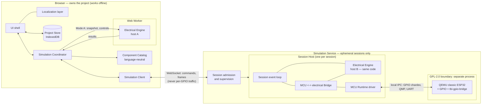
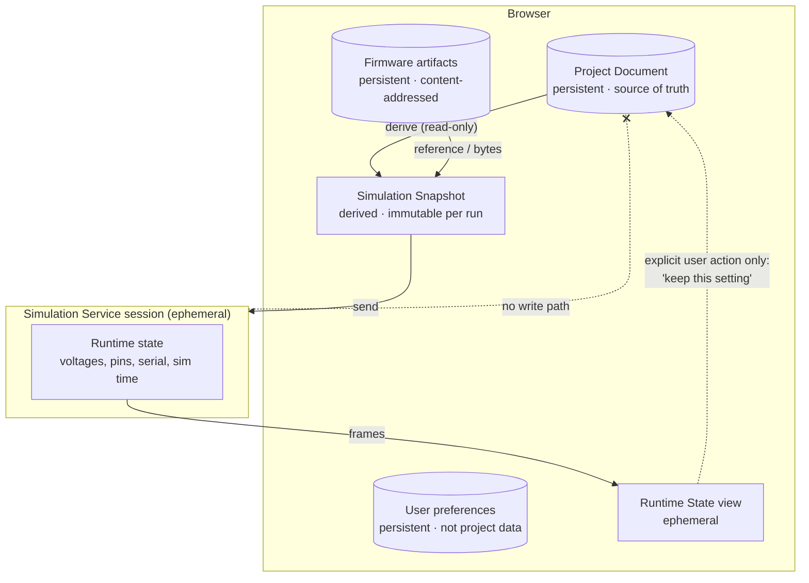
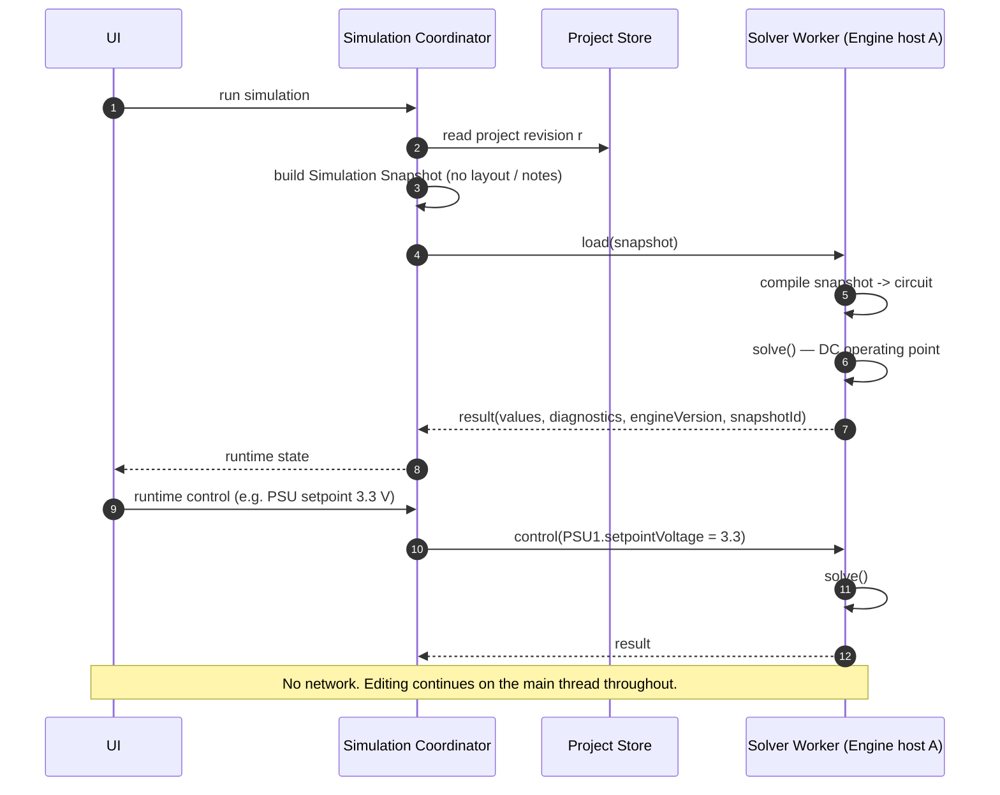
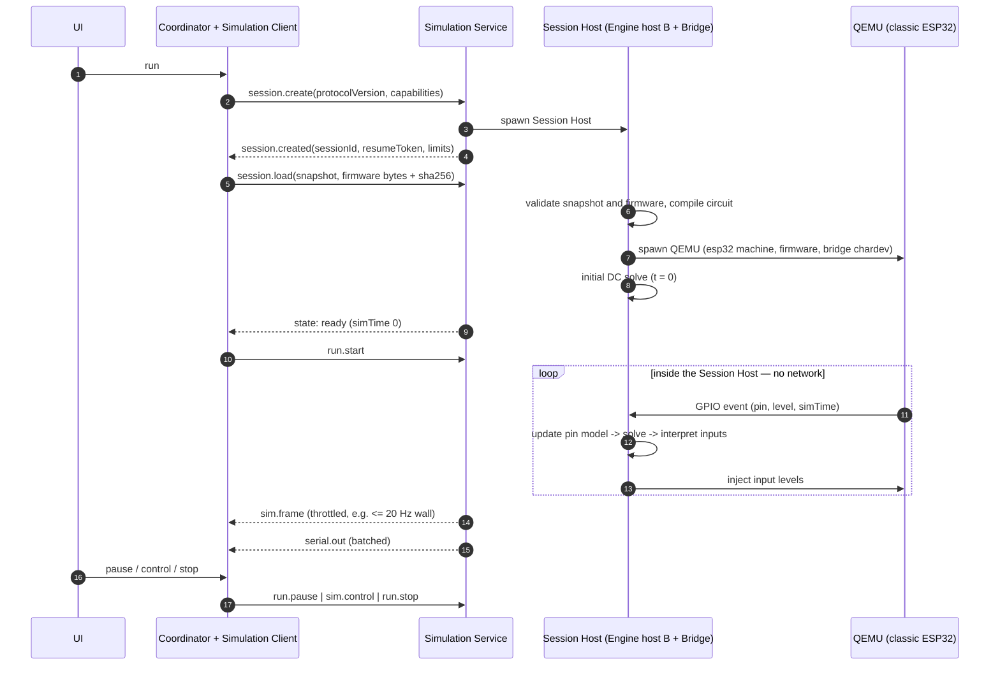
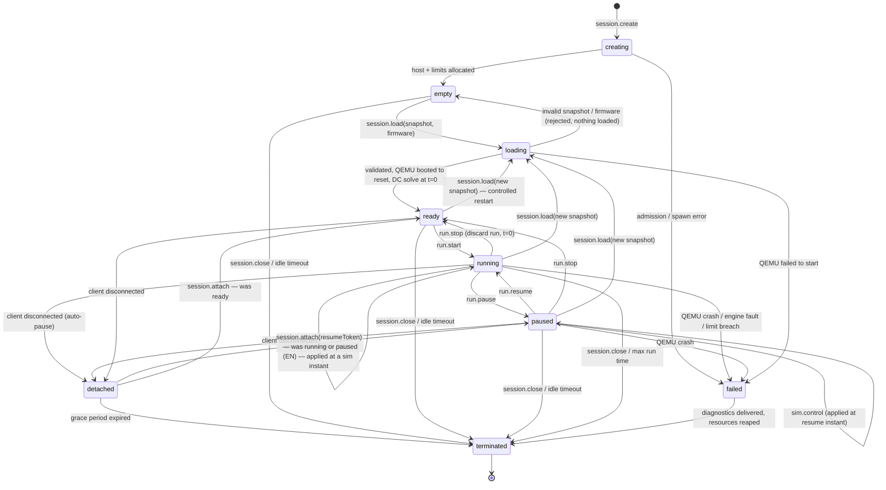
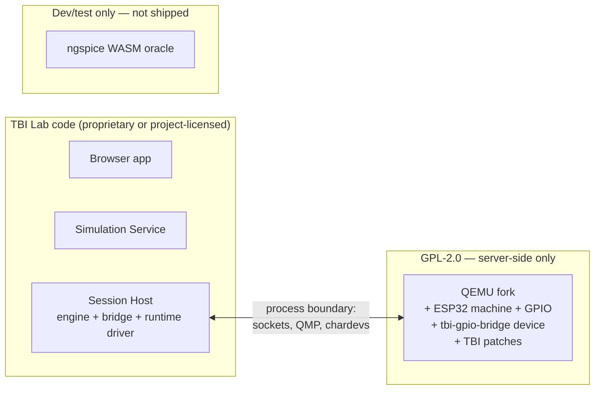

# TBI Lab — V1 Architecture

**Status:** DRAFT for PM review (Sprint 1). Authoritative once approved.
**Baseline:** tag `sprint-0-complete` (commit `d782e4a`). Evidence references point into that tree
and into the Sprint 1 research note `docs/research/sprint-1-simulation-time.md`.
**Decision records:** `docs/architecture/adr/`.

> **North star.** The browser owns the project. The simulation service owns only an ephemeral
> execution session. A project never becomes server-owned because it contains an ESP32.

---

## 0. How to read this document

- §1-§3 define **what exists and who owns what**.
- §4-§9 define **how simulation runs**: the two execution modes, the session, the protocol, time, the
  electrical engine and the MCU runtime.
- §10-§16 define **contracts and constraints**: firmware, security, resources, failure, versioning,
  licensing, localization.
- §17 lists the **invariants** every implementation sprint must preserve. §18 lists **decisions,
  assumptions, open questions and risks**, including those needing PM input.

"Proven" means demonstrated by a test in the Sprint 0 tree or a Sprint 1 spike. "Measured" figures
come from the 1-core ARM64 dev host and are **not** production projections.

---

## 1. System boundaries

### 1.1 Components

**Browser (the product; works offline):**

| Component | Responsibility |
|---|---|
| **UI shell** | Editing, presentation, controls. Not built in Sprint 1. |
| **Project Store** | The project source of truth: IndexedDB repository, schema validation, migrations, autosave, revision metadata. Promoted from the Gate D design. |
| **Component Catalog** | Language-neutral component type definitions (terminals, parameters, units, model binding). Display text lives in the localization layer, not here. |
| **Localization layer** | Locale, text direction, translation keys, terminology glossary, locale-aware *formatting* (never storage). |
| **Simulation Coordinator** | Chooses the execution mode (§4), builds immutable **Simulation Snapshots** from the project, owns the lifecycle of whichever simulation is active, and routes runtime state to the UI. |
| **Local Solver Worker** | Mode A host of the Electrical Engine, in a Web Worker. |
| **Simulation Client** | Mode B: WebSocket client for a remote simulation session. |

**Server (Mode B only):**

| Component | Responsibility |
|---|---|
| **Simulation Service** | One service. It terminates WebSocket connections, admits sessions, enforces limits, and spawns, supervises and reaps Session Hosts. It holds **no project data** beyond live sessions. |
| **Session Host** (one per session) | A single process. It hosts the Electrical Engine (the same code as the browser), the MCU <-> electrical Bridge, the MCU Runtime driver and the session event loop. |
| **QEMU process** (one per session) | The classic-ESP32 emulator: a separate OS process, connected to its Session Host over local IPC (chardev socket for GPIO, QMP for lifecycle, a chardev for UART). This is the GPL boundary (§15). |

No other services exist in V1: no separate firmware service, database, message broker or
orchestrator. Authentication and project sync are future boundaries (§2.6) and are **not**
designed here.

### 1.2 Overall system diagram



The Mode B feedback loop (QEMU -> Bridge -> Engine -> Bridge -> QEMU) is entirely inside one
machine. The WebSocket carries commands and throttled observation frames only (ADR-004).

---

## 2. Project ownership and the local-first model (ADR-001)

### 2.1 Source of truth

The **Project Document in the browser's Project Store is the only source of truth** for project
content. Every other copy is derived and disposable:

| Artifact | Owner | Lifetime | May be lost without losing work? |
|---|---|---|---|
| Project Document | Browser (IndexedDB) | Persistent | **No** — this is the work |
| Firmware artifacts | Browser (IndexedDB, content-addressed) | Persistent | No |
| User preferences (locale, UI state) | Browser, **separate from projects** | Persistent | Yes |
| Simulation Snapshot | Derived from a project revision | Per run | Yes |
| Simulation runtime state (voltages, pin levels, serial log, sim time) | Solver Worker or Session Host | Ephemeral | **Yes, always** |
| Simulation session | Simulation Service | Ephemeral | Yes, always |

### 2.2 Persistent state is not runtime state

`persistent project state != simulation runtime state` is a type-level rule, not a convention:

- The Project Document contains only **what the user designed**: components, parameters, nets,
  layout, instruments' *settings*, MCU instances, firmware references, run configuration, labels
  and notes.
- Runtime values — node voltages, currents, pin levels, supply mode (CV/CC), serial output,
  simulated time, LED "lit" state — live in a separate **Runtime State** model. They are **never**
  written into the Project Document.
- A value that is *both* a setting and runtime-adjustable (e.g. a PSU setpoint turned during a run)
  exists twice: the **project value** (persistent) and the **runtime value** (session). Changing it
  during a run changes only the runtime value. Writing it back to the project is an explicit user
  action ("keep this setting"), handled by the browser as an ordinary project edit.

### 2.3 What is sent to the simulation service

Only an immutable **Simulation Snapshot**: the minimum needed to simulate. It contains component
instances with type IDs and parameters, nets, MCU instances, firmware artifact bytes or reference
with hash, and run configuration. It **excludes** layout, labels, notes, project name and
revision history — none of these affect physics, and not sending them reduces exposure.

Each snapshot carries `snapshotId` (hash of its canonical content), `projectId` and the
`projectRevision` it was derived from, so every result can be traced to the exact design it
belongs to.

### 2.4 The server never mutates project state

The Simulation Service has **no write path** to the project. It cannot reach the browser's store,
and its protocol has no "update project" message. It returns runtime state and diagnostics only.

### 2.5 Connectivity matrix

| Capability | Offline | Needs the simulation service |
|---|---|---|
| Create, edit, save, reopen projects | ✅ | — |
| Switch UI language | ✅ | — |
| Simulate circuits without an MCU (Mode A) | ✅ | — |
| Simulate a project containing an ESP32 (Mode B) | ❌ | ✅ |
| Keep editing while a Mode B session is lost | ✅ | — |

If the server disappears, the network drops, or the session crashes, **editing and saving continue
unaffected**. Only the Mode B run stops, and the UI says so (§13).

### 2.6 Future sync boundary (not designed)

Cloud sync, when it comes, will sit **beside** the Project Store and replicate Project Documents
using the revision fields already persisted since Gate D (`localRevision`, `cloudRevision`,
`baseRevision`, `updatedAt`, `deviceId`). It will not route through the Simulation Service, and
simulation will never depend on it.

### 2.7 Data ownership diagram



---

## 3. Project schema (conceptual) (ADR-005)

### 3.1 Language independence — the rule

> **One project. Any locale. Same electrical truth.**
> A project created with a Hebrew UI opens identically with an English UI, and vice versa, with no
> migration or rewrite. The same will hold for every locale added later.

1. Component **type IDs** are namespaced and language-neutral: `component.resistor`,
   `mcu.esp32_classic`.
2. **Property keys** are language-neutral identifiers: `resistance`, `setpointVoltage`.
3. **Enum values** are language-neutral tokens: `"cv"`, `"output"`, `"dio"`.
4. **Technical values** are stored as numbers in SI units, with canonical unit IDs (`"ohm"`,
   `"volt"`, `"ampere"`). Locale affects only how they are *displayed*.
5. **No translated catalog text is persisted** as project data. `Resistor` / `נגד` / `Widerstand`
   are rendered from translation keys at display time.
6. **User-authored text** (project name, labels, notes, custom net names, firmware comments) is
   stored **exactly as entered** and never replaced, translated or normalized because the UI
   language changed.
7. **One project, not one per language.** Project identity (`projectId`) contains no locale.

### 3.2 Representative example

Illustrative only; this is not a frozen wire format.

```json
{
  "projectId": "prj_01J8Z6K4Q7R3",
  "schemaVersion": 2,
  "createdWith": { "app": "0.1.0", "schemaVersion": 2 },
  "revision": {
    "localRevision": 14,
    "cloudRevision": null,
    "baseRevision": null,
    "updatedAt": "2026-09-22T10:15:00.000Z",
    "deviceId": "8eba27ed-18e4-40c0-98e3-eea2dae83153"
  },
  "name": "נורית מהבהבת",

  "components": [
    { "id": "PSU1", "type": "instrument.lab_psu", "typeVersion": 1,
      "params": { "setpointVoltage": { "value": 5, "unit": "volt" },
                  "currentLimit":    { "value": 0.1, "unit": "ampere" },
                  "outputEnabled": true } },
    { "id": "U1", "type": "mcu.esp32_classic", "typeVersion": 1,
      "params": { "board": "board.esp32_devkitc", "firmwareRef": "fw_sha256_d069fffc27f7d724" } },
    { "id": "R1", "type": "component.resistor", "typeVersion": 1,
      "params": { "resistance": { "value": 220, "unit": "ohm" } } },
    { "id": "D1", "type": "component.led", "typeVersion": 1,
      "params": { "model": "model.led.vishay_tlhr5400" } }
  ],

  "nets": [
    { "id": "N_GND",  "role": "ground", "userName": null },
    { "id": "N_VCC",  "userName": null },
    { "id": "N_LED",  "userName": "קו הנורית" }
  ],
  "connections": [
    { "component": "PSU1", "terminal": "positive", "net": "N_VCC" },
    { "component": "PSU1", "terminal": "negative", "net": "N_GND" },
    { "component": "U1",   "terminal": "pin.3v3",  "net": "N_VCC" },
    { "component": "U1",   "terminal": "pin.gnd",  "net": "N_GND" },
    { "component": "U1",   "terminal": "gpio.2",   "net": "N_LED" },
    { "component": "R1",   "terminal": "a",        "net": "N_LED" },
    { "component": "R1",   "terminal": "b",        "net": "N_D1A" },
    { "component": "D1",   "terminal": "anode",    "net": "N_D1A" },
    { "component": "D1",   "terminal": "cathode",  "net": "N_GND" }
  ],

  "layout": {
    "R1": { "x": 40, "y": 10, "rotation": 90 },
    "D1": { "x": 80, "y": 10, "rotation": 0 }
  },

  "firmware": [
    { "artifactId": "fw_sha256_d069fffc27f7d724", "target": "esp32",
      "format": "esp32.flash_image.merged", "sha256": "d069fffc…cdd44",
      "flash": { "size": "4MB", "mode": "dio", "freq": "40m" },
      "producer": { "kind": "arduino-cli", "coreVersion": "esp32:esp32@3.3.12" },
      "userLabel": "blink v2" }
  ],

  "runConfig": { "timing": "virtual" },

  "annotations": [
    { "id": "A1", "kind": "note", "anchor": { "component": "R1" },
      "text": "לבדוק ערך נגד מול הדאטהשיט" }
  ]
}
```

Notes on the example:

- `name`, `nets[].userName` and `annotations[].text` are **user-authored** and deliberately in
  Hebrew here. They are shown as-is under every locale.
- Nothing else is language-specific. Under an English UI the same file renders "Lab power supply",
  "Resistor 220 Ω", "LED"; under Hebrew it renders the Hebrew terms from the catalog. **The file is
  byte-identical in both cases.**
- `layout` is separate from `components`, so the simulation snapshot can omit it (§2.3).
- The PSU is a **component instance**, not a special top-level `psu` block as in the Gate D
  feasibility schema. This allows more than one supply.
- `typeVersion` lets a component definition evolve without a whole-project migration.
- `firmwareRef` points at a content-addressed artifact, so identical firmware is stored once.

### 3.3 Schema evolution

- `schemaVersion` is an integer, and migrations are pure functions `vN -> vN+1`, run in the
  browser when a project is opened.
- A project with a **newer** schema than the app supports opens **read-only** with an explicit
  message. The app never guesses (§13).
- Gate D's feasibility schema (v1: un-namespaced types, singleton `psu`) needs a v1 -> v2 migration
  if any v1 data is ever kept. Assumption: no user data exists yet, so v2 can start clean.

---

## 4. Simulation execution modes (ADR-002)

### 4.1 Mode A — browser-local (no MCU)



**Worker boundary (message contract):** `load(snapshot)`, `control(target, param, value)`,
`solve()`, `dispose()`, answered by `result` or `error` carrying `snapshotId` and `engineVersion`.
The Worker never touches IndexedDB, the DOM or localization. It receives and returns
language-neutral data only.

### 4.2 Mode B — hybrid ESP32



The loop marked "no network" is the Gate C bridge, relocated server-side. **No step of the MCU <->
electrical loop crosses the WebSocket.**

### 4.3 How the mode is chosen

| Project contains | Mode |
|---|---|
| No MCU instance | **A** — browser-local |
| At least one `mcu.esp32_classic` instance | **B** — hybrid session |

Decisions:

- **An MCU in the circuit always means Mode B**, including when no firmware is assigned. An
  unpowered or unprogrammed ESP32 is not electrically "absent": its pins have protection
  structures, and modelling them as open circuits would invent behaviour. To simulate without the
  MCU, the user removes it from the circuit. A validated "MCU held in reset" model would be a
  later, explicit addition.
- The mode is **derived** from the snapshot, never stored as a user preference, so a project cannot
  be forced into the wrong mode.
- A Mode B project **offline** gives an explicit "simulation needs a connection" state. Editing is
  unaffected.

---

## 5. Simulation session model

### 5.1 Decisions

1. **Topology is immutable while a session holds a loaded snapshot.** Structural edits (add,
   remove or rewire components; change component types; change firmware) never hot-mutate a
   session. Applying them is a **controlled restart**: `session.load` with a new snapshot, which
   returns the session to `ready` at simulated time 0.
2. **Runtime controls are dynamic.** A defined set of commands may change during a run: PSU
   setpoint, current limit and output enable; switch or button positions; potentiometer position
   when that exists. Each is applied at a defined simulation instant (§7) and echoed with that
   instant.
3. **`reset` means the ESP32's reset (EN) event, not "start over".** It restarts the firmware at
   the current simulation time while the circuit stays powered, as pressing EN does on a real
   board. **`stop`** ends the run and returns to `ready` at t = 0.
4. **Client disconnect never kills a session immediately.** The session auto-pauses and enters
   `detached` for a grace period. It then either reattaches or expires.

### 5.2 State machine



`failed` and `terminated` are final. A new run needs a new session, which the client can create
automatically from the unchanged project.

---

## 6. Browser <-> simulation protocol

### 6.1 Transport

**WebSocket for V1.** It is bidirectional, ordered, supports both JSON and binary frames, and every
target browser supports it. WebRTC data channels, WebTransport and polling were considered: the
first adds signalling complexity for no benefit here, WebTransport is not needed at V1 frame rates,
and polling cannot push serial output or state changes promptly.

- Control, state and serial messages travel as **JSON text frames**.
- The firmware image (≤ 4 MB for the validated flash layout) is sent **once per load** as a binary
  frame, preceded by a JSON header that declares its `sha256` and size. The server verifies the
  hash before use.
- One WebSocket per session.

### 6.2 Envelope

Every message:

```json
{ "v": 1, "type": "run.start", "sessionId": "ses_…", "seq": 42, "cmdId": "c-42" }
```

| Field | Meaning |
|---|---|
| `v` | `protocolVersion`. The server rejects unsupported versions with `protocol_mismatch` before anything else. |
| `sessionId` | Absent only on `session.create`. |
| `seq` | Per-direction monotonic sequence. The server executes client commands **strictly in `seq` order**; a gap is buffered briefly, and after a timeout it is an error. |
| `cmdId` | Client-chosen correlation ID. Every command gets exactly one `cmd.result` with the same `cmdId`. |
| `simTimeNs` | On every server event that refers to simulation state. |
| `wallTime` | Server wall-clock timestamp, for diagnostics only. **Never** used for physics. |

### 6.3 Client -> runtime (conceptual)

```json
{ "v":1, "type":"session.create", "seq":1, "cmdId":"c1",
  "client": { "app":"0.1.0", "engineVersion":"eng-1.0.0+sha.ab12" } }

{ "v":1, "type":"session.load", "sessionId":"ses_7f", "seq":2, "cmdId":"c2",
  "snapshot": { "snapshotId":"snp_sha256_…", "projectId":"prj_01J8…", "projectRevision":14,
                "schemaVersion":2, "components":[…], "nets":[…], "connections":[…],
                "runConfig": { "timing":"virtual" } },
  "firmware": { "artifactId":"fw_sha256_d069…", "sha256":"d069fffc…", "bytes":4194304,
                "target":"esp32", "format":"esp32.flash_image.merged",
                "flash": { "size":"4MB", "mode":"dio", "freq":"40m" } } }
/* followed by one binary frame containing the image */

{ "v":1, "type":"run.start",  "sessionId":"ses_7f", "seq":3, "cmdId":"c3", "snapshotId":"snp_sha256_…" }
{ "v":1, "type":"run.pause",  "sessionId":"ses_7f", "seq":4, "cmdId":"c4" }
{ "v":1, "type":"sim.control","sessionId":"ses_7f", "seq":5, "cmdId":"c5", "snapshotId":"snp_sha256_…",
  "target":"PSU1", "param":"setpointVoltage", "value":{ "value":3.3, "unit":"volt" } }
{ "v":1, "type":"mcu.reset",  "sessionId":"ses_7f", "seq":6, "cmdId":"c6", "target":"U1" }
{ "v":1, "type":"run.stop",   "sessionId":"ses_7f", "seq":7, "cmdId":"c7" }
{ "v":1, "type":"session.attach", "sessionId":"ses_7f", "seq":1, "cmdId":"a1",
  "resumeToken":"…", "lastEventSeq":1830 }
{ "v":1, "type":"session.close", "sessionId":"ses_7f", "seq":8, "cmdId":"c8" }
```

### 6.4 Runtime -> client (conceptual)

```json
{ "v":1, "type":"cmd.result", "seq":101, "cmdId":"c5", "ok":true, "appliedAtSimTimeNs":1832000000 }

{ "v":1, "type":"session.state", "seq":102, "state":"running", "simTimeNs":1832000000,
  "snapshotId":"snp_sha256_…" }

{ "v":1, "type":"sim.frame", "seq":103, "simTimeNs":1850000000, "frameOf":"latest",
  "nets":    { "N_LED": { "voltage": 3.2051 } },
  "components": {
    "D1":   { "current": 0.0057540 },
    "PSU1": { "mode":"cv", "current": 0.0061 },
    "U1":   { "gpio": { "2": { "dir":"output", "level":1, "togglesSinceLastFrame":0 } } } },
  "pace": { "simPerWall": 0.31 } }

{ "v":1, "type":"serial.out", "seq":104, "port":"uart0", "simTimeNs":1851000000,
  "data":"IN=1\n" }

{ "v":1, "type":"error", "seq":105, "cmdId":"c9", "code":"stale_snapshot",
  "message":"command references snpA; session holds snpB", "retryable":false }

{ "v":1, "type":"session.failed", "seq":106, "reason":"runtime_crash",
  "detail":{ "component":"qemu", "exitSignal":"SIGSEGV" }, "simTimeNs":2003000000 }
```

### 6.5 What is deliberately not streamed

No QEMU instructions, individual solver iterations, Newton steps or per-transition GPIO events.
`sim.frame` carries the **latest** values of UI-relevant quantities, plus aggregates such as
`togglesSinceLastFrame` so that fast activity is visible without flooding the link. Frame rate is
set by the client (default ≤ 20 Hz wall-clock) and is **independent of simulation progress** (§7.6).

Aggregates are **counts, not inferred physics**. The protocol never reports a PWM-averaged
"voltage" as a DC value: that would invent behaviour the DC engine does not model.

### 6.6 Ordering, staleness and errors

- **Ordering.** Commands execute in `seq` order. Server events are totally ordered by server `seq`
  and carry `simTimeNs`.
- **Stale commands.** Commands that depend on a snapshot carry `snapshotId`. If it is not the
  loaded snapshot, the command is rejected with `stale_snapshot` and is never applied to the wrong
  design. State-invalid commands (e.g. `run.pause` in `ready`) return `invalid_state`.
- **Error codes** (initial set): `protocol_mismatch`, `invalid_state`, `stale_snapshot`,
  `invalid_snapshot`, `unsupported_component`, `unsupported_schema`, `invalid_firmware`,
  `unsupported_target`, `limit_exceeded`, `engine_nonconvergence`, `runtime_crash`, `internal`.
  Each carries `retryable`.

### 6.7 Reconnect

`session.create` returns a `resumeToken`. After a disconnect, the client sends `session.attach`
with `lastEventSeq`. The server answers with a **full `session.state` and `sim.frame`** — runtime
state is small, so resending it is simpler and safer than event replay — plus the retained tail of
`serial.out` after `lastEventSeq`, from a bounded buffer (e.g. 64 KB). If the tail was truncated,
it says so.

---

## 7. Simulation time and determinism (ADR-007)

This is where the evidence is weakest, so this section states exactly what is proven, what is
targeted, and what is not claimed. Evidence: `docs/research/sprint-1-simulation-time.md`.

### 7.1 Two clocks, never mixed

| Clock | Source | Used for |
|---|---|---|
| **Simulation time** | QEMU's virtual clock (`QEMU_CLOCK_VIRTUAL`) under `-icount` | Ordering, stamping events, firmware timers, when controls apply |
| **Wall-clock time** | Host and browser clocks | Pacing, UI frame rate, timeouts, diagnostics |

**Wall-clock time never enters an electrical calculation.** The Electrical Engine is a pure function
of (snapshot, pin states, runtime controls). That is proven: the solver is deterministic and
bit-identical between Node and browser (Gate A).

### 7.2 How simulated time advances

- QEMU runs in **instruction-count mode** (`-icount shift=3,sleep=off`). Virtual time advances by
  8 ns per executed instruction, and jumps directly to the next timer deadline when the guest is
  idle. This is the **only validated setting**. `shift=2` (closer to the real 240 MHz) was unstable
  and `sleep=on` was not reproducible.
- **Consequence to state plainly:** the virtual CPU runs at the equivalent of **125 MHz**. Code
  timed by ESP32 peripheral timers (`delay()`, FreeRTOS ticks, timer interrupts) is accurate in
  simulated time — `delay(200)` measured exactly 200.000 ms. **Instruction-bound code** (busy
  loops, heavy computation) takes about **1.9x longer in simulated time** than on a 240 MHz chip.
  V1 is not cycle-accurate and does not claim to be.

### 7.3 Electrical solve points

The DC engine is quasi-static: between events the network does not change, so no solve is needed.
Solves occur only at:

1. **t = 0**, after `session.load` (initial operating point);
2. each **GPIO level or direction change** emitted by the MCU;
3. each **runtime control**, at its application instant;
4. each **MCU reset (EN)** event.

Each solve is an event at one simulation instant, processed in emission order: update the pin
models, solve, interpret digital inputs (datasheet V_IH/V_IL with hold in the undefined band), then
inject any changed input levels. Gate C measured the whole step at about 3 ms of wall-clock time.

### 7.4 Guarantees — honest tiers

| Tier | Guarantee | Status |
|---|---|---|
| **G1** | Electrical results depend only on snapshot, pin states and controls — never on wall time, network or host load | **Proven** (Gate A determinism; Gate C independent-solver agreement) |
| **G1** | Within a session, every event has a simulation timestamp and a single total order; commands apply in `seq` order at recorded instants | **By design**; mechanisms proven in Gate C |
| **G1** | The MCU's own event timeline is reproducible across runs of the same firmware | **Proven** under `icount shift=3,sleep=off`: 6/6 identical, 0 ns divergence |
| **G2 (target)** | Electrical responses are visible to firmware **at the same simulation instant** as the output that caused them (zero-delay DC response), **and** the whole closed loop is bit-reproducible run to run | **Not yet achieved.** Zero-lag response was measured (0 ns, `inline` spike), and a reproducible MCU timeline was measured (icount), but **not both at once**: holding the vCPU perturbed the timeline, and pausing at a TB boundary let the reply land non-deterministically |
| — | Cycle accuracy; real-silicon instruction timing; analog/transient effects | **Not claimed in V1** |

**The strongest V1 guarantee we can state today is G1.** G2 is the V1 target. It is an explicit
implementation item for the next runtime sprint, with a named hypothesis — apply bridge responses
at a deterministic stop point, such as a `cpu_exit` at the GPIO write under icount — and an existing
acceptance test (`experiments/sprint-1-spikes/lockstep_check.py`, which must report identical
acknowledgements across runs). **If G2 cannot be achieved, V1 ships with G1, and the UI must not
imply bit-reproducible replay.** This is flagged for PM input (§18).

### 7.5 Pause, reset, stop

- **Pause:** the VM stops, so virtual time freezes (icount). The engine is idle. Controls issued
  while paused take effect at the paused instant, when the run resumes.
- **MCU reset (EN):** a simulation event at the current time. The firmware restarts, the circuit
  stays powered and the network state persists, as on real hardware.
- **Stop:** discards the run. The next start begins at t = 0 from the same snapshot.

### 7.6 Pacing and the UI

- Simulation progresses as fast as the host allows, capped at real time for interactive runs. On
  a fast host the cap is applied by **pausing the VM between slices**; virtual time is frozen while
  paused, so pacing cannot alter the simulated timeline.
- On a slow host, the simulation runs **slower than real time**. The dev host measured **0.31x**.
  The UI must show the ratio (`pace.simPerWall`) rather than hide it: a 1 Hz blink then visibly
  blinks at about 0.3 Hz of wall time, while the simulation still reports 1 Hz of *simulated* time.
- UI frames are throttled independently (§6.5). Rendering never slows or speeds the simulation.

---

## 8. Electrical engine architecture (ADR-008)

### 8.1 One engine, two hosts

The Gate A solver (`experiments/gate-a-electrical/src`) and the Gate C pin model
(`experiments/gate-c-bridge/src/pinModel.ts`) are promoted — **deliberately, not rewritten** — into
a single package, the **Electrical Engine**, with two thin hosts:

| Host | Where | Adds |
|---|---|---|
| **A — Solver Worker** | Browser Web Worker | message adapter only |
| **B — Session Host** | Server, inside each Mode B session | the MCU Bridge (Gate C `bridge.ts`, relocated) |

Both hosts run **the same built artifact**, identified by one `engineVersion`. Divergence is guarded
by a cross-host test that asserts bit-identical results in Node and in a browser Worker. Gate A
already does this for the LED case; it becomes a CI requirement across the reference suite.

### 8.2 Boundaries

```
Simulation Snapshot (language-neutral JSON)
      │  compile()        — resolves nets -> node indices, instantiates component models,
      ▼                     rejects unknown types/terminals with structured errors
CompiledCircuit
      │  solve(pinStates, controls)   — pure; no I/O, no timers, no DOM, no locale
      ▼
SolveResult { nodeVoltages, componentObservables, supplyModes,
              diagnostics { residuals, iterations }, engineVersion, snapshotId }
```

- **Component-model boundary.** Each catalog `type` maps to a model implementing the existing
  `Device` contract: stamp, exact terminal currents, residual. Component *definitions* (terminals,
  parameters, units) live in the catalog; the *physics* lives in engine models. There is no
  catalog/UI knowledge inside models.
- **Nodes and nets.** Nets are persistent project objects with stable IDs. Nodes are engine-internal
  indices compiled from nets, rebuilt on every compile and never persisted. Ground is the net with
  `role: "ground"`. A circuit without one is rejected with an explicit error, rather than
  receiving an invented reference.
- **Deterministic I/O.** Inputs and outputs are plain data. Node ordering is by insertion; there is
  no hash-order dependence. This is already true of the Gate A code.
- **Errors never yield partial results.** `SingularMatrixError`, `ConvergenceError` (including the
  residual-verification rejection added in Gate A), `UnsupportedComponentError` and
  `InvalidTopologyError` surface as structured diagnostics. In Mode B, non-convergence **pauses**
  the run and reports it (§13). It never substitutes a guess.
- **Future transient boundary.** `solve()` stays the DC operating point. A later `step(dt, state)`
  with companion models (capacitors, inductors) will extend the Device contract with per-model
  state in and out. Nothing in V1 precludes it, and nothing in V1 implements it. AC analysis is out
  of scope.

---

## 9. MCU runtime boundary

### 9.1 Interface (conceptual)

```ts
interface McuRuntime {
  readonly target: 'esp32';            // classic ESP32 only — see 9.2
  load(image: FirmwareImage): Promise<void>;          // validate + prepare; no execution
  start(): Promise<void>;                              // boot from reset
  pause(): Promise<void>;
  resume(): Promise<void>;
  resetEn(): Promise<void>;                            // EN/reset event at current sim time
  terminate(): Promise<void>;
  simTimeNs(): bigint;

  onGpio(cb: (e: { pin: number; level?: 0|1; direction?: 'output'|'input'; simTimeNs: bigint }) => void): void;
  injectInput(pin: number, level: 0|1): void;          // applied per §7 semantics
  onSerial(cb: (e: { port: 'uart0'; bytes: Uint8Array; simTimeNs: bigint }) => void): void;
  onFault(cb: (e: { kind: 'crash'|'hang'|'limit'|'invalid_image'; detail: string }) => void): void;
}
```

The only implementation is **`QemuEsp32Runtime`**. It drives a separate QEMU process through:

| Channel | Carries |
|---|---|
| `tbi-gpio-bridge` chardev | GPIO events and injection (Gate C protocol, extended with timestamps) |
| QMP | stop, cont, system_reset, quit |
| UART chardev | serial output |

The interface is shaped by what the product needs, not by QEMU internals, so a different emulator
could replace QEMU behind it without touching the engine, the protocol or the browser. That is the
only abstraction added: one interface, one implementation, no plugin layer.

### 9.2 Classic ESP32, explicitly

- `target` is the literal `'esp32'`: the original ESP32 (Xtensa LX6, dual-core) of common DevKit
  boards.
- Firmware images are checked against the ESP image header's chip ID. A non-classic image (C3, S3,
  C6, …) is **rejected** with `unsupported_target` and is never run on a "close enough" model.
- The runtime build is pinned (§14). Swapping the emulated chip is a product decision, never an
  implementation shortcut.

---

## 10. Firmware artifact boundary

The runtime consumes a **Firmware Artifact** and does not care where it came from.

| Field | Meaning | Validated at `session.load` |
|---|---|---|
| `artifactId` | `fw_sha256_<prefix>`; identity **is** the content hash | hash of received bytes |
| `sha256` | full hash | must match bytes |
| `target` | `esp32` | must equal runtime target; image header chip ID checked |
| `format` | `esp32.flash_image.merged` (bootloader + partitions + app at offsets, whole flash) | size = flash size, ESP image magic `0xE9` at `0x1000` |
| `flash` | `size`, `mode`, `freq` | `mode` must be supported by the runtime version — **QIO is currently rejected** (Sprint 0: stalls at "Failed to set QIE bit"; build with DIO) |
| `producer` | `{kind, toolchain/core version}` — informational | not trusted for anything |
| `runtimeCompat` | set of runtime versions it has been validated on (optional) | informational |

- **Producers.** An integrated compiler, a server compiler, a local compiler, an uploaded binary or
  a future workflow all end in the same artifact. **No editor or compiler workflow is designed in
  Sprint 1.**
- **Supported feasibility directions**, proven in Sprint 0: Arduino (official `esp32:esp32` core,
  FQBN `esp32:esp32:esp32`, `FlashMode=dio`) and MicroPython (`ESP32_GENERIC` prebuilt images).
  These are recorded as directions, not features.
- Artifacts are stored in the browser, content-addressed, and sent to the session per load. The
  server keeps them only for the lifetime of the session.

---

## 11. Session isolation and security

**User firmware and snapshots are untrusted input.** These are logical requirements; the
deployment technology (containers, VMs, seccomp profiles, cgroups) is chosen later.

| Concern | Requirement |
|---|---|
| Process isolation | One QEMU process **per session**, unprivileged, never shared between users. Session Hosts are never shared between sessions. |
| CPU | Per-session CPU cap (planning figure: 1 core; §12). A runaway guest can only consume its own allowance. |
| Memory | Per-session hard limit (planning figure: 512 MB for QEMU + Session Host); exceeding it fails the session, never the host. |
| Time limits | Idle timeout with no client and no activity; `detached` grace period; maximum run duration per session. |
| Guest networking | **None.** QEMU is started without network devices or user-mode networking, and no host-forward. (The ESP32 Wi-Fi/Ethernet models remain unused.) |
| Filesystem | QEMU sees only a per-session scratch directory holding the flash image copy. No host paths, no shared directories, removed on reap. |
| Host interfaces | No QEMU monitor exposed outside the Session Host; QMP and chardevs bound to per-session local sockets; no GDB stub in production. |
| Malformed firmware | Validated before QEMU starts (§10). QEMU crash or hang -> `failed` with diagnostics, never a host-wide effect. |
| Malformed snapshot | Schema-validated and size-limited (components, nets, message bytes) **before** compile. Engine errors are structured. |
| Denial of service | Per-client session limits, admission control on host capacity, bounded message sizes, bounded serial and event buffers, server-side frame-rate caps. |
| Cleanup | Terminating a session kills QEMU and the Session Host, deletes scratch state, and releases limits. This is idempotent and runs on every exit path, including crashes. |

Authentication and authorization are **out of scope** for Sprint 1, but they are **required before
the Simulation Service is exposed publicly** (§18).

---

## 12. Resource model

### 12.1 Measured inputs (Sprint 0 and Sprint 1, 1-core Neoverse-N1)

| Quantity | Value |
|---|---|
| QEMU RSS, MicroPython idle (Espressif build) | ~209 MB |
| QEMU RSS, Arduino firmware, real-time mode | ~204 MB |
| QEMU RSS, Arduino firmware, `icount` (V1 mode) | 84-132 MB |
| QEMU CPU, Arduino firmware, real-time | ~0.8 core |
| QEMU CPU, Arduino firmware, `icount` | ~0.91 core (CPU-bound: runs until paced or at host speed) |
| QEMU CPU, idle MicroPython REPL, real-time | ~0 % |
| Simulated/real-time ratio, `icount`, this host | **0.31x** |
| Boot to MicroPython REPL (native, real-time) | 3.29 s |
| First Arduino application GPIO event | ~12.9 s **simulated** time — see risk R3 |
| Engine: nonlinear DC solve | 0.07-0.09 ms |
| Bridge: event -> solve -> inject | ~3 ms wall (Gate C) |
| Session Host (Node) baseline RSS | *not measured*; planning assumption ~60-80 MB |

### 12.2 The dominant cost is CPU

The electrical engine is negligible: about 0.1 ms per solve, and solves occur only on GPIO events.
**QEMU dominates.** In the V1 `icount` mode an active session uses about **one core** until it is
paced to real time. Memory is second-order: roughly 150-300 MB per session, including the Session
Host.

### 12.3 Planning examples (estimates, not commitments)

Assumptions: every session is actively running (the worst case), 1 core and ~300 MB each (QEMU plus
Session Host plus headroom), and 20 % host reserve.

| Concurrent active sessions | Cores | Memory |
|---|---|---|
| 10 | ~12 | ~4 GB |
| 50 | ~60 | ~18 GB |
| 100 | ~120 | ~36 GB |

Mitigations that change these numbers, and that should be measured before any infrastructure
decision:

- **Real-time pacing** caps CPU on hosts faster than real time, because a paced session idles
  between slices.
- **Paused, detached and idle sessions** cost memory only, not CPU.
- **Faster cores matter more than more cores.** QEMU `icount` is single-threaded per session, so the
  0.31x ratio can only be raised by per-core speed.

**This dev server is not representative of production.** Per-core speed on production-class x86 or
Graviton hosts will change the pace ratio and CPU figures substantially, and must be measured (§18).

---

## 13. Failure and recovery model

**Invariant: an ephemeral simulation failure can never lose project work.** Project data is written
locally before and independently of any simulation, and no simulation path can write to it.

| Event | Project work | Simulation | User sees |
|---|---|---|---|
| Browser refresh | Intact (autosaved) | Mode A: re-run locally. Mode B: session `detached`; reattach with `resumeToken` if stored, otherwise it expires | Run resumes paused, or "session ended — start again" |
| Browser crash | Intact up to the last autosave (debounce window, milliseconds) | Session detaches, then expires | Same as refresh |
| Temporary network loss | Intact; editing continues | Session auto-pauses (`detached`); reattach within grace restores state and serial tail | "Reconnecting…", then resumes paused |
| Server runtime crash (QEMU or Session Host) | Intact | `failed` with diagnostics | "Simulation stopped: runtime error"; one action to start a new session |
| Simulation timeout (idle or max run) | Intact | `terminated` | "Session ended after inactivity" |
| Firmware crash (guest panic or reboot loop) | Intact | **Not** a session failure: the guest crash is simulated behaviour, and serial output shows it. A hard QEMU fault is `failed` | Firmware's own crash output in the serial view |
| Solver non-convergence | Intact | Mode A: result replaced by the error. Mode B: run **pauses** at that simulation instant with `engine_nonconvergence` | Which instant and which components, rather than a wrong number |
| Protocol mismatch | Intact | Refused at `session.create` | "Update required" |
| Stale snapshot | Intact | Command rejected (`stale_snapshot`); the Coordinator reloads the current revision (controlled restart) | Brief restart |
| Unsupported project schema (newer than the app) | Intact, **read-only** | Not started | "Created with a newer version" |

---

## 14. Versioning

Only dimensions that answer "what exactly produced this result?" are kept.

| Dimension | Form | Where it appears |
|---|---|---|
| `schemaVersion` | integer | project document, snapshot |
| component `typeVersion` | integer per type | each component instance |
| `protocolVersion` | integer | every message (`v`) |
| `engineVersion` | semver + build hash | every solve result; `session.state` |
| `runtimeVersion` | Session Host build (semver + hash) | `session.state` |
| `qemuBuild` | upstream fork + commit + our patch set hash (e.g. `a159x36@03be9af0+tbi.p1(sha)`) | `session.state` |
| `firmware` | `artifactId` (content hash) | snapshot and `session.state` |
| `snapshotId` | content hash of the canonical snapshot | every result |

**Reproducibility requirement.** A bug report carries `{snapshotId, firmware artifactId,
engineVersion, runtimeVersion, qemuBuild, runConfig}`. With those, the exact run environment can be
reconstructed. With G2 achieved (§7.4), the exact event timeline can be too. The Mode A equivalent is
`{snapshotId, engineVersion}`.

Not versioned separately: the catalog as a whole (covered by per-type `typeVersion`) and the
localization bundles (they cannot change results, by §16).

---

## 15. Licensing boundary (ADR-006)

Engineering and compliance constraints only; this is not legal advice.



- QEMU runs **server-side only** in V1, as a **separate process** behind IPC. No application code
  is linked into it. Everything *inside* the box — including our `tbi_gpio_bridge.c` and the GPIO
  fixes — is GPL-2.0 and tracked as such.
- **No approval exists to ship QEMU (native or WASM) to browsers.** Nothing in the V1 browser
  bundle contains QEMU.
- **Provenance** for every QEMU change is recorded (SPRINT-0.md §15): upstream fork, commit, patch
  files and licence headers. The production QEMU build will carry a manifest of the same form (§14
  `qemuBuild`).
- The missing COPYING file in Espressif's **prebuilt binary** is a packaging/compliance finding. Our
  licence record uses the authoritative source-tree licensing.
- **Formal legal/licence review** of the QEMU integration is required before commercial
  distribution.
- **ngspice-wasm stays a dev/test oracle**: not a production dependency until its build and licence
  composition is resolved.

---

## 16. Localization / internationalization

Launch locales are English (`en`) and Hebrew (`he`), with first-class RTL. The architecture is **N
locales, not two**: no `isHebrew` logic, and no English/Hebrew duplicate objects.

| Kind of text/value | Stored as | Rendered by |
|---|---|---|
| Component type, terminal, parameter, enum | language-neutral IDs (`component.resistor`, `terminal`, `cv`) | catalog + translation keys |
| Component names and descriptions | **not stored in projects** | translation key -> locale bundle / glossary |
| Numbers and units | SI number + canonical unit ID | locale-aware formatting (decimal separator, grouping); unit symbols per glossary |
| System messages, warnings, errors | protocol/engine **codes** (`engine_nonconvergence`) | translation keys |
| User-authored names, labels, notes, net names | **as entered, verbatim** | shown as-is in every locale |
| Firmware source and serial output | bytes/text as produced | always LTR, never translated |

- **Engines and the protocol are language-free.** Errors travel as codes with structured
  parameters, and the browser localizes them. The server never produces localized text.
- **RTL does not reach technical content.** The circuit canvas, coordinates, component identifiers
  (`R1`), GPIO labels, values, units, formulas, code and serial output stay LTR or
  direction-independent under a Hebrew UI. Changing locale never rearranges the circuit.
- **No per-language projects.** `projectId` is locale-free, and one document opens under any
  locale.
- Future search (`displayName.<locale>`, `keywords.<locale>[]`, `aliases[]`) belongs in catalog
  metadata. The project schema does not block it.

---

## 17. Architecture invariants

Every implementation sprint must preserve these. A change that breaks one requires a new ADR.

1. **The browser's local project data is the project source of truth.**
2. **Losing a simulation session — for any reason — cannot lose project work.**
3. **Ordinary circuit simulation without an MCU does not require the server.**
4. **WAN latency is never inside the MCU <-> electrical feedback loop.** QEMU, bridge and engine
   are co-located in one Session Host.
5. **The classic ESP32 is never silently replaced** by another MCU or ESP32 family member. Images
   for other targets are rejected.
6. **Persisted engineering and project data is language-independent.**
7. **Changing UI language never rewrites project data,** including user-authored text.
8. **There is one electrical engine.** Browser and server run the same build; results are
   cross-checked for bit-identity.
9. **Runtime state and persistent project state are separate concepts and separate types.**
10. **Feasibility experiments stay separate from production code** unless deliberately promoted,
    and promotion is recorded.
11. **Wall-clock time never influences an electrical value.** Simulation time and wall time are
    separate clocks (§7.1).
12. **The simulation service has no write path to project data.**
13. **Unsupported behaviour fails explicitly** (unknown component, non-convergence, unsupported
    flash mode, wrong target). It is never approximated silently.
14. **Untrusted firmware runs only inside a per-session, network-less, resource-limited QEMU
    process.**
15. **QEMU stays behind a process boundary** and is never linked into, or shipped with, the browser
    application.

---

## 18. Decisions, assumptions, open questions and risks

### 18.1 Decisions made in this document

| # | Decision | Record |
|---|---|---|
| 1 | The browser owns the project; the server owns only ephemeral sessions | ADR-001 |
| 2 | Two execution modes, derived from the snapshot: A (no MCU) local, B (MCU) hybrid | ADR-002 |
| 3 | Classic ESP32 runs server-side in V1 | ADR-003 (from Sprint 0 B1) |
| 4 | QEMU, bridge and engine co-located per session; the WebSocket carries only commands and throttled frames | ADR-004 |
| 5 | Language-neutral project schema; user text verbatim | ADR-005 |
| 6 | QEMU is a separate GPL-2.0 process, server-side only | ADR-006 (from Sprint 0 B2) |
| 7 | Simulation time = QEMU virtual clock under `icount shift=3,sleep=off`; tiered guarantees G1 (now) / G2 (target) | ADR-007 |
| 8 | One electrical engine package, two hosts | ADR-008 |
| 9 | Topology immutable during a session; edits = controlled restart; runtime controls dynamic | §5.1 |
| 10 | `reset` = ESP32 EN event within the run; `stop` = back to t = 0 | §5.1 |
| 11 | An MCU in the circuit always means Mode B; no "absent MCU" approximation | §4.3 |
| 12 | WebSocket; JSON control, binary firmware upload; full-state resync on reattach | §6 |
| 13 | QIO firmware rejected by the V1 runtime (DIO required) | §10 |

### 18.2 Assumptions

- No V1 user data exists yet, so schema v2 can start clean (Gate D v1 is feasibility-only).
- A Session Host (Node) costs roughly 60-80 MB. *Not measured.*
- One QEMU process and one Session Host process per session is acceptable at V1 scale. Pooling
  Session Hosts is a later optimisation.
- Firmware images stay ≤ 4 MB (validated flash layout).
- UI frames at ≤ 20 Hz are sufficient for V1 presentation.

### 18.3 Decisions that need PM input before implementation

| # | Question | Why it matters |
|---|---|---|
| P1 | **Accept G1 as the V1 floor, with G2 (bit-reproducible closed loop) as a target item for the next runtime sprint?** If G2 is mandatory for V1, it becomes a gating deliverable, not a target. | Determines whether "replay" can ever be a product promise |
| P2 | **Approve measuring the runtime on production-class hardware** before any capacity or infrastructure plan. The dev host runs deterministic simulation at 0.31x real time. | Whether V1 simulation feels real-time at all |
| P3 | **`icount` (deterministic, possibly slower than real time) as the only V1 timing mode**, with no real-time mode? Real-time mode is faster on this host but irreproducible (9.5 s divergence). | Product feel vs trustworthiness |
| P4 | **Session start latency.** Emulated Arduino boot reaches `setup()` after ~12.9 s of *simulated* time (real chip: < 1 s). Approve investigating it as a runtime work item? | First-run experience |
| P5 | **Session policy defaults**: idle timeout, detach grace, maximum run length, concurrent sessions per user | Cost and abuse control |
| P6 | **Authentication before any public exposure** of the Simulation Service. Confirm it is required before, or in, the first sprint that deploys it. | Security |
| P7 | **Unsupported flash modes**: reject QIO with a clear message (current decision), or convert images server-side? | Upload UX |
| P8 | **Production QEMU baseline** (Preference A: GPIO on a maintained Espressif baseline). Schedule it now that QEMU is server-side. | Maintenance burden |

### 18.4 Risks

| # | Risk | Impact | Mitigation |
|---|---|---|---|
| R1 | Deterministic mode too slow on production hosts | Simulation visibly slower than real time | Measure (P2); pace display honestly; faster cores |
| R2 | G2 not achievable with QEMU's current mechanisms | Replay not bit-reproducible | G1 is still solid; hypothesis and test defined; fallback documented |
| R3 | Long emulated boot | Slow first run | Investigate (P4); keep sessions warm across controlled restarts where the firmware is unchanged |
| R4 | ~1 core per active session | Hosting cost | Pacing; pause idle and detached sessions; measure (P2) |
| R5 | Carrying QEMU fork patches (GPIO, bridge, fixes) | Maintenance on Espressif rebases | Preference A baseline; offer fixes upstream |
| R6 | GPL obligations for the server-side QEMU | Compliance | Process boundary; provenance manifest; legal review before distribution |
| R7 | Engine divergence between hosts | Different physics in A and B | Single build; bit-identity CI test |
| R8 | `shift=3` virtual CPU is ~1.9x slower than real silicon for instruction-bound code | Timing-sensitive firmware behaves differently from hardware | Documented; peripheral-timer timing is exact; revisit `shift` once stable |

### 18.5 Promotion plan (for later sprints, not Sprint 1)

| Feasibility code | Promoted to | Changes allowed |
|---|---|---|
| `gate-a-electrical/src` + `gate-c-bridge/src/pinModel.ts` | Electrical Engine package | packaging, compile-from-snapshot front end; **physics untouched** |
| `gate-c-bridge/src/bridge.ts` | Session Host bridge | timestamped events, G2 mechanism |
| `gate-c-bridge/qemu-patch/*` | production QEMU patch set | provenance manifest |
| `gate-d-persistence/src` | Project Store | schema v2, migrations |

Every promotion is a deliberate, reviewed step with its own tests carried over, per invariant 10.
