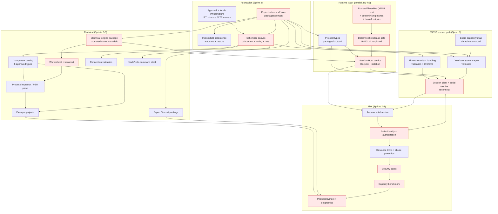

# TBI Lab — V1 Implementation Roadmap

**Status:** APPROVED (with PM corrections RC-1..RC-7, applied below) · **Date:** 2026-09-22 · **Baseline:** tag `v1-product-scope-complete`
(commit `09d5089`)

**Inputs, all approved and closed:** `docs/sprints/SPRINT-0.md` + `SPRINT-0-ERRATA.md` (feasibility),
`docs/architecture/V1-ARCHITECTURE.md` + ADR-001..008 (architecture, tag `sprint-1-complete`),
`docs/product/V1-PRODUCT-SCOPE.md` (product scope, PM-1..PM-8), `CLAUDE.md`.

**What this document is.** The plan to build the approved V1 controlled pilot: milestones organised as
user-visible vertical slices, concrete sprints from Sprint 2, the dependency graph and critical path,
and the gates that must be met before the pilot. **It is a plan. Nothing here is implemented.**

**Scope guard.** This roadmap introduces nothing outside the approved scope. Capacitor, transient,
potentiometer, multimeter, oscilloscope, PWM, ADC/DAC, I2C/SPI, Wi-Fi/Bluetooth, MicroPython
authoring, breadboard, cloud sync, collaboration, mobile and AI are **absent by construction**. Where
a dependency looked like it needed one, it is flagged in §17 rather than quietly added. No such
contradiction was found.

### Roadmap closure — PM corrections (approved 2026-09-22)

The roadmap was approved with the following corrections. They are applied in the body of this
document; this table is the index.

| # | Correction | Where applied |
|---|---|---|
| RC-1 | **Schema v2 core freezes at the end of Sprint 2**, not Sprint 3. Sprint 2 is the first sprint that persists real product data, so its model is not disposable. From Sprint 3 on, schema changes are additive/backward-compatible where possible, and an explicit migration is required whenever persistence semantics change | §6.1, §6.4, §3 (Sprint 2/3), §17 risk 2, §18.3, §19 |
| RC-2 | **The proven community QEMU fork is a development contingency, not an approved pilot runtime.** R1 must port the GPIO work and both determinism fixes onto the maintained Espressif baseline and re-run the release gate. If that port fails materially, the old runtime may keep unblocking development/testing, but **pilot runtime selection becomes a PM/architecture blocker** — it is never shipped silently | §3 (R1), §9, §17 risk 1, §18.3 |
| RC-3 | **The four QEMU patch artifacts are reclassified `Promote` -> `Adapt / Port`.** Their logic is proven and must be preserved, but the artifacts are not production-ready until ported to the selected maintained baseline, reviewed against it, rebuilt reproducibly and revalidated by the deterministic gate. The release-gate test stays **Promote**; the electrical solver/model code stays **Promote** | §1.2 |
| RC-4 | **Sprint 2 CI must not depend on the ~9.8 GB unversioned ESP32 toolchain.** It covers the fast product path only. The real-ESP32 suite becomes a separate provisioned CI/release-gate job after R1 makes the runtime reproducible. No routine product PR depends on `/home/ubuntu/tbi-tools/` | §1.1, §14.3, Sprint 2 plan |
| RC-5 | **Product maturity milestones are named separately:** First Working Screen (end of Sprint 2), Product Alpha / Demoable Lab (~Sprint 4/5), ESP32-enabled Alpha (after Sprint 6/7), Controlled Pilot Ready (end of Sprint 8). There is no single "V1 date" | §18.4 |
| RC-6 | **No PM decision on pilot audience size yet.** Capacity benchmarking stays parameterized; the decision is taken before Sprint 8 completion from measured data. Infrastructure is never dimensioned from the dev host | §16.3, §18.3, Sprint 2 plan §11 |
| RC-7 | Approved product scope is not reopened by any of the above | — |

---

## 1. Repository readiness audit

### 1.1 What exists today

| Fact | Value |
|---|---|
| Production application code | **None.** No `src/`, `app/`, `server/` or `packages/` directory exists |
| Feasibility code | 38 files, **5,338 lines** under `experiments/` (30 TypeScript / 4,445 lines; 8 Python / 893 lines) |
| Tests | **81 cases**: 55 Node unit (vitest), 20 real-ESP32 integration (vitest esp32 config), 4 browser (Playwright), plus 2 opt-in WASM measurement cases |
| Dependencies | **No runtime dependencies at all.** Six devDependencies: `typescript` 5.9, `vitest` 3.2, `@playwright/test` 1.63, `@types/node`, `eecircuit-engine` (ngspice oracle, dev-only), `fake-indexeddb` |
| Configuration | 4 tsconfigs, 2 vitest configs, 1 Playwright config (Chromium only), a 19-line `.gitignore` |
| **CI** | **Absent.** No `.github/`, no pipeline of any kind. Seven npm scripts are the only automation |
| **Lint / format** | **Absent.** No ESLint, Prettier or editorconfig |
| Committed binaries | **None.** No tracked file exceeds 100 KB; the largest is `package-lock.json` (56 KB). Patches and Arduino sources are text |
| External dependency | **~9.8 GB** under `/home/ubuntu/tbi-tools` (QEMU sources and builds, Arduino core and toolchain, firmware images), referenced by **hard-coded absolute paths**, with **no setup script or manifest in the repo** |
| Git | Branch `main`, clean tree, 88 tracked files, three annotated tags (`sprint-0-complete`, `sprint-1-complete`, `v1-product-scope-complete`) |
| Toolchain on the host | Node 24.21, npm 11.19, Python 3.14.4, TypeScript 5.9.3, `arduino-cli` 1.5.1 (on disk only, not on PATH), three `qemu-system-xtensa` builds (on disk only) |

**Three readiness gaps that the roadmap must close, none of which is product scope:**

1. **No CI.** Every gate this roadmap defines (determinism, reference cases, performance, bit-identity)
   is only as real as its automation. Sprint 2 introduces CI for the **fast product path only**; it
   must not depend on the unversioned ESP32 toolchain (RC-4). The real-ESP32 suite becomes a separate
   provisioned job after R1.
2. **No reproducible runtime provisioning.** The ESP32 tests depend on 9.8 GB of un-versioned state at
   absolute paths. Before the runtime track can be trusted — and long before a pilot deploys — the
   runtime needs a pinned, scripted provisioning path (versions, checksums, build recipe). Sprint R1.
3. **No lint/format baseline.** Cheap to add with the first production package; it prevents style
   churn across sprints. Sprint 2.

### 1.2 Classification — Promote / Adapt / Disposable

**Promote** = the logic is production-suitable with bounded cleanup. **Adapt / Port** = the logic is
proven and must be preserved, but the artifact is not production-ready until ported to its production
base, reviewed there, rebuilt reproducibly and revalidated (RC-3). **Adapt** = technically valid and
must inform production, but should not be copied in. **Disposable** = evidence and harness; it stays
where it is and never becomes product architecture.

| Current location | Lines | Class | Reason | Production target | Dependencies / risks |
|---|---:|---|---|---|---|
| `gate-a-electrical/src/circuit.ts` | 302 | **Promote** | The MNA solver: active-set CV/CC, Newton with limiting, exact-equation verification, deterministic. Proven against analytic results and ngspice | `packages/engine/` solver core | Needs a stable public API and structured error types; no algorithmic change |
| `gate-a-electrical/src/devices.ts` | 414 | **Promote** | Device stamps and exact residuals for R, I, V, LabPsu (CV/CC), Diode/LED with `pnjlim` | `packages/engine/` device models | Needs a model **registry** and parameter schemas instead of hand construction |
| `gate-a-electrical/src/models.ts` | 131 | **Promote** | Physical constants and the datasheet-traceable LED card with provenance | `packages/engine/` model cards | Add diode + extra LED cards, each datasheet-sourced |
| `gate-a-electrical/src/linalg.ts` | 75 | **Promote** | Dense LU with partial pivoting; ample at tens of nodes | `packages/engine/` internals | None. Sparse storage stays out of V1 |
| `gate-c-bridge/src/pinModel.ts` | 167 | **Promote** | Datasheet-derived GPIO pad model (driver resistances, pulls, leakage, V_IH/V_IL with hold). Implements the engine `Device` interface | `packages/engine/` MCU pin model | Pin **modes** must be driven by the runtime and by the board capability map |
| `gate-d-persistence/src/store.ts` | 98 | **Promote** | Minimal IndexedDB wrapper, proven across a real full-browser restart | `app/` persistence layer | Needs migrations, error handling and a project index; the `Illegal invocation` defect is already fixed here |
| `gate-d-persistence/src/autosave.ts` | 58 | **Promote** | Debounced autosave with an injectable timer; proven to coalesce a burst | `app/` persistence layer | Needs save-state reporting for the UI indicator |
| `sprint-1-spikes/tests/closed-loop.esp32.test.ts` | 69 | **Promote** | **The release gate (R-MCU-1)** with pinned fingerprints | Production ESP32 test suite | Fingerprints must be re-pinned on the new QEMU baseline |
| `sprint-1-spikes/esp32-appcpu-reset-determinism.patch` | 18 added | **Adapt / Port** | Required for determinism; logic proven | `runtime/qemu/` patch set | Must be ported to, reviewed against and rebuilt on the maintained Espressif baseline, then revalidated by the release gate |
| `sprint-1-spikes/icount-warp-race-determinism.patch` | 18 added | **Adapt / Port** | Required for determinism; generic QEMU core fix; logic proven | `runtime/qemu/` patch set + upstream candidate | Same |
| `gate-c-bridge/qemu-patch/gpio-enable-gating.patch` | 42 lines | **Adapt / Port** | Correct GPIO drive gating; without it inputs inject phantom sources | `runtime/qemu/` patch set | Same |
| `gate-c-bridge/qemu-patch/tbi_gpio_bridge.c` + `sprint-1-spikes/tbi_gpio_bridge.sprint1-spike.diff` | 192 + 413 | **Adapt / Port** | The bridge device incl. the synchronous `syncport` mode and virtual tick that make determinism possible | `runtime/qemu/` bridge device | Spike-only properties (`sync`, `inline`, keepalive) should be dropped; bank-1 output support added |
| `gate-c-bridge/src/bridge.ts` | 120 | **Adapt** | Correct event→solve→inject logic, but written for the asynchronous Sprint 0 loop | `server/session-host/` bridge | The production bridge is synchronous (exchange on the emulator thread); the *semantics* transfer, the transport does not |
| `gate-c-bridge/src/qemuLink.ts` | 124 | **Adapt** | The line protocol is right; the chardev transport is superseded by syncsock | `server/session-host/` | Reuse the wire vocabulary, not the socket code |
| `sprint-1-spikes/closed-loop/closedLoop.ts` | 246 | **Adapt** | The best existing reference for the production session loop: verified pristine flash copy, stimulus scheduling in simulation time, full fingerprinting | `server/session-host/` session loop | It is a harness: single-run, process-spawning, test-shaped. The *design* transfers |
| `gate-a-electrical/browser/worker.ts` | 140 | **Adapt** | Proves the Worker pattern and message shape | `app/` Worker host | Production needs cancellation, error propagation and a typed protocol |
| `gate-d-persistence/src/projectState.ts` | 96 | **Adapt** | The revision metadata (`localRevision`, `cloudRevision`, `baseRevision`, `updatedAt`, `deviceId`) is proven and carries forward; the component shape is a feasibility stub (`type: 'resistor' \| 'led' \| 'psu' \| 'mcu'`, one `value`, one `psu` block) | `packages/domain/` schema v2 | **Do not promote the component shape.** Schema v2 is designed in §6 from the architecture's §3, not from this file |
| `gate-a-electrical/src/api.ts` | 72 | **Adapt** | Its own header calls it "a shape demonstration, not a committed interface"; `stepSimulation(dt)` with an unused `dt` | `packages/engine/` public API | Informs the API; is not the API |
| `gate-c-bridge/src/qemuRuntime.ts` | 180 | **Disposable** | Test harness that spawns QEMU with REPL plumbing; marked "Not product code". Also the source of errata E-2 (attaches firmware writable) | — | Production supervision is a service concern, not a test helper |
| `gate-d-persistence/browser/app.ts` | 98 | **Disposable** | Exposes an imperative API on `window` for Playwright; explicitly "not a UI" | — | — |
| All 8 Python spikes (`time_determinism`, `repeat_check`, `lockstep_check`, `noise_check`, `warp_race_stress`, `boot_timing`, `timing_fidelity`, `gpio_probe`) | 893 | **Disposable** | Measurement and root-cause instruments, stdlib-only, hard-coded paths. They are the evidence for ADR-007 | — | Keep runnable for re-measurement; never product code |
| `closed-loop/findDivergence.ts`, `closed-loop/stressRuns.ts` | 44 | **Disposable** | Debugging aids that found the two determinism defects | — | Keep as evidence |
| `gate-a-electrical/tests/*` (4 files, 35 cases) | 740 | **Promote (logic) + keep** | Reference cases, solver refusal behaviour, LED sensitivity, ngspice cross-check | Production engine tests; ngspice cross-check **stays** in `experiments/` as a dev-only oracle (licence composition unresolved) | The oracle must never become a shipped dependency |
| `gate-c-bridge/tests/pinModel.test.ts` (11 cases) | 128 | **Promote (logic)** | Datasheet conformance of the pin model | Production engine tests | — |
| `gate-c-bridge/tests/*.esp32.test.ts` (19 cases) | 509 | **Adapt** | Gate B/C evidence on the real runtime | Production ESP32 suite re-expresses these against the production stack | Keep the originals frozen as historical regression references |
| `gate-d-persistence/tests/state.test.ts` (9 cases) | 131 | **Adapt** | `fake-indexeddb` tests, explicitly not the acceptance evidence | Production persistence tests | Real-browser acceptance stays the evidence |
| `gate-a-electrical/browser/browser.spec.ts`, `gate-d-persistence/browser/persistence.spec.ts` | 339 | **Adapt** | The two browser acceptance proofs (bit-identity in a Worker; restore across a real browser restart) | Production browser suites re-express both against the real app | These two behaviours are product acceptance criteria, not just tests |
| `gate-b-esp32/*` (probe, WASM bench, lx6-bench) | 387 + assets | **Disposable** | The record of why the MCU runs server-side | — | Never revisited unless browser emulation technology changes |

**Summary:** 8 items to promote (the entire electrical core, the pin model, persistence primitives and
the release-gate test), 4 to adapt/port (the QEMU patch set: two determinism fixes, GPIO enable
gating, the bridge device), 8 to adapt (session loop, bridge semantics, Worker pattern, revision
metadata, and the acceptance-test behaviours), and the rest stays as evidence. **Roughly 1,300 lines
of proven logic can be promoted**, which is why Milestone B is reachable in Sprint 3 rather than late.
The QEMU patches are not counted as production-ready until R1 has ported and revalidated them.

---

## 2. Milestones (user-visible vertical slices)

Each milestone ends in something a person can be shown. No milestone is "a layer".

| Milestone | Demonstrable outcome | Ends when |
|---|---|---|
| **A — First working product screen** | The real application: create a local project, place PSU/ground/resistor on a schematic canvas, wire them, switch Hebrew/English, close the browser and reopen with everything intact | A person can build and keep a (not yet simulated) circuit |
| **B — First electrical vertical slice** | The same project **runs**: real solver results from the browser Worker, inspected voltages and currents, stop, edit, rerun, reopen | No fake simulation state anywhere in the product |
| **C — Complete non-MCU V1** | The whole approved non-MCU product: full catalog minus MCU, connection validation, probes, PSU CV/CC panel, examples, export/import, error UX, undo/redo, project management, localization acceptance | A user could be given the product for DC circuit work |
| **D — ESP32 vertical slice** | A classic ESP32 DevKit in the circuit, capability-map-driven pins, an authenticated session running a supported `.bin`, deterministic GPIO <-> electrical interaction, serial monitor, session lifecycle and reconnect | The headline product claim works end to end |
| **E — Integrated Arduino workflow** | Single `.ino` -> Build -> artifact -> Run, on the pinned toolchain | A student writes code in TBI Lab and sees it drive the circuit |
| **F — Controlled-pilot readiness** | Production runtime baseline, auth/limits/isolation, capacity benchmark, browser acceptance, final examples, pilot documentation and diagnostics | The pilot can be handed to invited users |

**Ordering rationale.** A and B come first because they retire the two largest *product* unknowns
(schematic interaction and engine integration) while the runtime track can proceed in parallel. D
depends on the browser foundation being stable enough that the MCU path is an addition, not a rewrite.

---

## 3. Sprint sequence

Sprints are **vertical slices**, sized so each ends in a demonstration. Two tracks run in parallel
after Sprint 3 — see §4 for why this is safe.

| Sprint | Track | Goal | Milestone |
|---|---|---|---|
| **Sprint 2** | Product | First real product surface: app shell, schema core, canvas, placement, wiring, persistence, he/en | A |
| **Sprint 3** | Product | Electrical vertical slice: production engine + Worker, Run/Stop, real results, LED | B |
| **Sprint 4** | Product | Catalog completion, connection validation, probes, PSU panel, undo/redo | C (part 1) |
| **Sprint R1** | Runtime *(parallel, from Sprint 4)* | Production QEMU baseline: Espressif baseline port, bank-1 outputs, fork demo devices removed, determinism patches carried, release gate green | D (prerequisite) |
| **Sprint 5** | Product | Project management, export/import, examples 1-4, error UX, localization + accessibility acceptance | C (complete) |
| **Sprint R2** | Runtime *(parallel)* | Session Host service: protocol, session lifecycle, per-session isolation, immutable base firmware + private writable flash, diagnostics | D (prerequisite) |
| **Sprint 6** | Product | ESP32 in the product: DevKit component, board capability map, pin validation, session client, serial monitor, reconnect, examples 5-6 | D |
| **Sprint 7** | Both | Arduino build service + integrated code workflow | E |
| **Sprint 8** | Both | Pilot hardening: auth/authorization, limits, abuse protection, security gates, capacity benchmark, browser acceptance, pilot docs | F |

**Not twenty tiny sprints, not three giant ones.** Eight sprints, each with a demonstration and a
gate. The runtime track (R1, R2) is separately numbered because it is parallel work with a different
skill profile, not a pause in the product track.

### Sprint 2 — First product surface *(detailed plan: `docs/sprints/SPRINT-2.md`)*

| Field | Content |
|---|---|
| **Goal** | A real TBI Lab application in which a user creates a local project, draws a small circuit on a schematic canvas and finds it intact after a full browser restart — in Hebrew or English |
| **User-visible outcome** | The product exists: app shell, project, canvas, placement, wiring, persistence, language switch |
| **In scope** | Production repo layout (`app/`, `packages/domain/`); schema v2 core (components, nets, connections, layout, values+units, revision metadata, schemaVersion, migration hook); app shell (menu, canvas, inspector panel); locale infrastructure with **complete** he/en for everything shipped; RTL chrome + LTR canvas; place/move/rotate/select/delete for **PSU, ground, resistor**; wire drawing with junction/net semantics; IndexedDB persistence with debounced autosave and save-state indicator; new/open/recent projects |
| **Out of scope** | Any simulation, Run control, LED/diode/button/switch, ESP32, undo/redo, probes, export/import, examples, server anything |
| **Acceptance** | See `docs/sprints/SPRINT-2.md` §8 — including the full-browser-restart restore and the Hebrew/English acceptance run |
| **Risks retired** | Schematic interaction feasibility; schema shape under real editing; RTL from day one. **Schema v2 core frozen at Sprint 2 DoD** (RC-1) |

### Sprint 3 — Electrical vertical slice

| Field | Content |
|---|---|
| **Goal** | The circuit the user drew actually solves, in the browser, with real numbers |
| **User-visible outcome** | Run and Stop; node voltages and component currents in the inspector; LED shows its real operating point; edit a value, rerun, see it change |
| **In scope** | Promote the Gate A engine into `packages/engine` with a stable API and a component-model registry; Worker host and transport; compile-from-snapshot (nets -> nodes); LED component with its model card; unit-aware property editing; run/stop state machine in the UI; first-class solver error surface (no ground, singular, non-convergence); engine determinism and reference-case tests carried into production tests |
| **Out of scope** | Probes as pinned overlays, PSU instrument panel, CV/CC UI polish, other components, any server work |
| **Acceptance** | Gate A's seven reference circuits reproduce **bit-identically** through the production engine and Worker; a deliberate no-ground circuit refuses to run with a specific message; edit-rerun loop stays responsive |
| **Risks retired** | Engine promotion; Worker transport; "no fake simulation state". Sprint 3 may **extend** the frozen schema core additively for engine needs; it must not casually replace the persisted Sprint 2 model |

### Sprint 4 — Catalog and interaction completion

| Field | Content |
|---|---|
| **Goal** | The approved non-MCU catalog, fully interactive and validated |
| **User-visible outcome** | Diode, push button and toggle switch work; buttons and switches change the circuit live; PSU panel shows CV/CC; probes pin values to the canvas; undo/redo across all edits |
| **In scope** | Diode model card; switch device model (documented closed/open resistances); live runtime interaction for button/switch; PSU instrument panel (setpoint, limit, enable, measured V/I, CV/CC); probes/inspector per PM-3 naming; connection validation rules (unconnected terminal, no ground, same-component short, duplicate connection); undo/redo as a command stack over the project document; rotate/multi-select completeness |
| **Out of scope** | ESP32, export/import, examples, build service |
| **Acceptance** | Each catalog component has a model with recorded provenance; CC entry is presented as normal behaviour, not an error; undo/redo survives 50 mixed operations; validation messages are specific and localized |
| **Risks retired** | Catalog closure; live-change semantics; validation UX |

### Sprint R1 — Production runtime baseline *(parallel track)*

| Field | Content |
|---|---|
| **Goal** | A production-grade classic-ESP32 runtime that still passes the deterministic release gate |
| **User-visible outcome** | None directly — this is the prerequisite that makes Milestone D possible. Its demonstration is the release-gate report |
| **In scope** | Port the GPIO work onto the maintained Espressif QEMU baseline (P8); carry both determinism patches (synchronous APP-CPU reset; icount warp race); add bank-1 (GPIO32/33) output events (blocker B6); remove the community fork's demo board devices from GPIO 4/16/27; per-session immutable base firmware with a private writable flash copy; keep the provenance manifest and licence records; re-run and re-pin the release-gate fingerprints |
| **Out of scope** | Any new peripheral (ADC/PWM/I2C/SPI/Wi-Fi/BT); reset paths; product UI |
| **Acceptance** | R-MCU-1 passes on the new baseline with stress, with new pinned fingerprints; GPIO32/33 outputs are evented and covered by the gate; no pin is masked for fork-specific reasons; patch provenance recorded; runtime provisioning is scripted and reproducible so the ESP32 suite can run as a separate provisioned CI/release-gate job |
| **If the port fails materially** | The proven community fork remains a **development contingency** only: it may keep unblocking development and testing while the issue is investigated. It is **not** an approved pilot runtime and is never shipped silently. Pilot runtime selection then becomes a **PM/architecture blocker** (RC-2) |
| **Risks retired** | The largest remaining technical unknown: whether the GPIO/bridge work survives a baseline change |

### Sprint R2 — Session Host service *(parallel track)*

| Field | Content |
|---|---|
| **Goal** | A real Session Host that the browser can drive over the approved protocol |
| **User-visible outcome** | None directly; demonstrated by a scripted client completing a full session lifecycle |
| **In scope** | `packages/protocol` message types shared by browser and server; Session Host process (QEMU + bridge + engine instance co-located per ADR-004); session state machine (create/load/run/pause/resume/stop/close, detach/attach with the P5 policy values); snapshot and firmware validation at load; serial buffering with a bounded tail; throttled observation frames; structured diagnostics; process isolation and guaranteed cleanup |
| **Out of scope** | Authentication (Sprint 8), the build service (Sprint 7), UI |
| **Acceptance** | A scripted client runs the full lifecycle including a forced disconnect and reattach within grace; one QEMU per session; cleanup verified on every exit path including crash; determinism preserved through the service layer |
| **Risks retired** | Protocol churn; session lifecycle; the "no WAN in the loop" invariant in real code |

### Sprint 5 — Non-MCU V1 completion

| Field | Content |
|---|---|
| **Goal** | The non-MCU product is complete and acceptable |
| **User-visible outcome** | Examples open and run; projects can be exported and imported; errors read well in both languages; the product feels finished for DC work |
| **In scope** | Project management (duplicate, delete, rename, recent list); portable export/import package (§12) with validating import; examples 1-4; the two-class error model in the UI (technical error vs noteworthy physical behaviour); localization acceptance pass across every screen; accessibility baseline (keyboard, focus, contrast, not-colour-alone); browser performance gates (§16) |
| **Out of scope** | ESP32, build service, auth |
| **Acceptance** | Milestone C acceptance run in both languages; export on one machine imports on another with identical engineering values; no English-only string anywhere |
| **Risks retired** | Export portability; localization completeness; error-UX quality |

### Sprint 6 — ESP32 in the product

| Field | Content |
|---|---|
| **Goal** | The headline claim, as a product feature |
| **User-visible outcome** | Place a DevKit, wire GPIO2 to an LED and a button to an input, load a supported `.bin`, run, watch firmware drive the circuit and the circuit drive the firmware, read the serial monitor, lose the connection and get it back |
| **In scope** | `mcu.esp32_classic` component with the DevKit symbol and real header labels; **board capability map** sourced from the datasheet and DevKit schematic; pin validation driven by that map (flash pins refused, input-only pins offer no pull, strapping pins flagged); schema additions for MCU config and firmware references; `.bin` upload with full artifact validation (target, magic, size, flash mode; QIO rejected, never converted); session client in the browser with explicit states; serial monitor (read-only); reconnect/grace behaviour; Mode B vs Mode A derivation from the snapshot; examples 5-6 |
| **Out of scope** | The Arduino editor/build (Sprint 7); authentication (Sprint 8, local dev unauthenticated); any unsupported peripheral |
| **Acceptance** | The Milestone D journey passes; a QIO image is rejected with the right diagnostic; an ESP32 project opens and edits **offline**; the same firmware and circuit produce the same observable behaviour on repeat runs |
| **Risks retired** | Capability-map correctness; MCU product path; determinism visible to the user |

### Sprint 7 — Integrated Arduino workflow

| Field | Content |
|---|---|
| **Goal** | Single `.ino` -> Build -> artifact -> Run inside the product |
| **User-visible outcome** | A student writes a sketch in TBI Lab, builds it, runs it, and sees compiler errors inline when it does not build |
| **In scope** | Build service (§10): one sketch, pinned core/toolchain, classic ESP32 only, DIO, sandboxed, timeouts, size and rate limits, result cache keyed by source + toolchain; artifact hashing and build metadata; code editor surface (plain, single file, no library manager); compiler diagnostics mapped to lines; build-latency measurement |
| **Out of scope** | Libraries, multi-file projects, board packages, debugging, serial upload |
| **Acceptance** | A sketch builds and runs end to end; a syntax error surfaces with the line; a cached rebuild is materially faster; the built artifact is DIO and passes artifact validation unchanged |
| **Risks retired** | Build latency; toolchain pinning; the security posture of compiling untrusted code |

### Sprint 8 — Controlled-pilot readiness

| Field | Content |
|---|---|
| **Goal** | The pilot can be handed to invited users |
| **User-visible outcome** | Invited users sign in for compute, everything local still works signed out, and the service behaves under load |
| **In scope** | Minimum invite-controlled identity (§11); authorization for the two services; per-user session and build limits; resource enforcement and abuse protection; security gates (§15); capacity benchmark at the chosen level (§16); browser acceptance on Chromium; pilot deployment and operational logging/diagnostics; final example pass; pilot documentation stating what is and is not supported |
| **Out of scope** | Public-scale abuse posture, cloud project storage, GA support processes, Firefox/Safari commitments |
| **Acceptance** | Signed-out users retain every local capability; the two services refuse unauthorized access; limits hold under a deliberate overload; the security checklist passes; capacity is measured on pilot hardware, not the dev host |
| **Risks retired** | Auth/security; cost and capacity; operational readiness |

---

## 4. Dependency graph and critical path



### 4.1 The true critical path

**Schema v2 core -> schematic canvas -> engine + Worker -> (QEMU baseline -> release gate -> Session
Host) -> ESP32 product path -> auth + security -> capacity benchmark -> pilot deployment.**

Two observations that decide the schedule:

1. **The QEMU baseline port (R1) is the longest single unknown**, and nothing in the product track
   depends on it. It must therefore start **as early as the runtime engineer is available**, not when
   the product track reaches Milestone D. If R1 slips, the pilot slips; if it starts late, the pilot
   slips by exactly that lateness.
2. **The schema is the only genuine cross-track coupling.** Everything else fans out from it. That is
   why §6 freezes the schema core before parallel work begins.

### 4.2 Safe parallelism

| Can run in parallel | Why it is safe |
|---|---|
| Runtime track (R1, R2) alongside product Sprints 4-5 | The runtime track consumes the **snapshot** and **protocol** contracts, not the editor. It touches no UI code |
| Board capability map research alongside R1 | It is data sourced from the datasheet and schematic; it has no code dependency |
| Example project authoring alongside Sprint 5 | Examples are project files plus acceptance text |
| Localization catalogue growth alongside every UI sprint | Keys are added with the UI that needs them, never afterwards |
| Build-service prototyping (latency measurement) alongside Sprint 6 | It needs only the toolchain and a sketch, not the product |

| Must **not** run in parallel | Why |
|---|---|
| Schema changes and any consumer sprint | Schema churn ripples into editor, engine, persistence, protocol and export at once (§6) |
| Protocol changes and Session Host / session client work | Two-sided churn; freeze `packages/protocol` before R2 and Sprint 6 overlap |
| Two sprints editing the canvas interaction model | Interaction code is the hardest to merge and the easiest to regress |
| Auth work before the session and build services exist | Authorization needs real surfaces to protect |

---

## 5. Production code boundary and repository layout

### 5.1 The rule

**Production code begins in new top-level directories. `experiments/` is frozen evidence and never
becomes the product.** Feasibility code enters production only by *promotion*: a deliberate copy into
a production package, with its tests carried over and the promotion recorded (architecture invariant
10). The experiment keeps working as the historical proof.

### 5.2 Minimal layout, introduced only when needed

| Path | Purpose | Introduced in |
|---|---|---|
| `app/` | The browser application (Vite + TypeScript): shell, canvas, panels, locale bundles, Worker client | Sprint 2 |
| `packages/domain/` | Project schema and types, validation, migrations, catalog metadata, capability maps. **Pure data, no UI, no I/O** | Sprint 2 |
| `packages/engine/` | The one Electrical Engine: solver, device models, pin model, compile-from-snapshot. Pure TypeScript | Sprint 3 |
| `packages/protocol/` | Simulation protocol message types and validation, shared by browser and server | Sprint R2 |
| `server/session-host/` | Session Host: QEMU supervision, bridge, engine instance, session lifecycle | Sprint R2 |
| `server/build-service/` | Arduino build service | Sprint 7 |
| `runtime/qemu/` | Carried QEMU patches, provenance manifest and build recipe (not QEMU source) | Sprint R1 |
| `experiments/` | **Unchanged.** Sprint 0/1 evidence | — |
| `docs/` | Existing documentation tree | — |

**Deliberately not introduced:** a monorepo tool (Nx/Turborepo/Lerna), a shared UI component library,
a plugin system, or a package per component type. npm workspaces plus project references are enough
at this size; adding more would be premature.

### 5.3 What stays permanently in `experiments/`

| Path | Why it stays |
|---|---|
| `experiments/gate-a-electrical/` | The original feasibility proof, including the ngspice cross-check and the browser Worker spec. The cross-check is a *reference oracle*, not product code |
| `experiments/gate-b-esp32/` | Runtime survey, GPIO probes, the WASM measurement. Historical record of why V1 runs the MCU server-side |
| `experiments/gate-c-bridge/` | The first bidirectional proof and its QEMU patch. Superseded by production code but is the evidence for Gate C |
| `experiments/gate-d-persistence/` | The IndexedDB proof, including the full-browser-restart test |
| `experiments/sprint-1-spikes/` | Determinism spikes, timing-fidelity harnesses, the two QEMU determinism patches and **the release-gate test**. The gate test is promoted in R1 but the spike history stays |

**Guard:** a CI check should fail if production imports from `experiments/`, and if `experiments/`
gains new non-evidence code. This keeps the boundary honest without forbidding reference reading.

---

## 6. Project schema implementation sequence

The schema is the highest-coupling artifact in the project. It becomes production-grade in three
steps, and **freezes** between them.

### 6.1 Step 1 — v2 core (Sprint 2, **frozen at Sprint 2 DoD**)

Sprint 2 is the first sprint that persists real product data, so this model is **not disposable**
(RC-1). By the Sprint 2 Definition of Done the following core concepts are stable: project identity
and schema version; component instance identity; stable language-neutral component type ids;
terminals/pins; nets; engineering values and units; position/rotation; revision metadata.

| Element | Decision for V1 |
|---|---|
| `schemaVersion` | Integer, starts at **2** (v1 was the Gate D feasibility shape) |
| Component instance ids | Stable, human-meaningful references (`R1`, `D1`, `SW1`, `U1`), unique per project, never reused after delete |
| Component **type** ids | Namespaced, language-neutral, versioned per type: `component.resistor` + `typeVersion` |
| Net ids | Opaque stable ids (`N_...`), with an optional user-authored name that is never translated |
| Terminal ids | Language-neutral per type (`a`/`b`, `anode`/`cathode`, `positive`/`negative`), and for the MCU, header-derived ids (`gpio.2`, `pin.3v3`) |
| Values | `{ value: number, unit: "ohm" \| "volt" \| "ampere" }` — SI numbers, canonical unit ids, locale affects formatting only |
| Layout | Separate `layout` map: `{x, y, rotation}` per component, excluded from the simulation snapshot |
| Labels / notes | User-authored text, verbatim, never localized |
| Revision metadata | `localRevision`, `cloudRevision: null`, `baseRevision: null`, `updatedAt`, `deviceId` — the Gate D fields, which already round-trip |
| Migration mechanism | A registry of `from -> to` migration functions run on open; a **newer** schema opens read-only |

**Rule applied:** no field is added for a speculative future feature. `cloudRevision` and
`baseRevision` are the sole exception, and they are carried because they already exist and cost
nothing — nothing acts on them.

### 6.2 Step 2 — MCU additions (Sprint 6, additive only)

`mcu.esp32_classic` params (`board`, `firmwareRef`, per-pin user configuration such as pulls), the
`firmware[]` artifact list (`artifactId`, `sha256`, `target`, `format`, `flash`, `producer`,
toolchain identity), and `runConfig`. These are **additive** to v2: an older project remains valid.

### 6.3 Step 3 — Export package (Sprint 5, extended in Sprint 6)

The package format wraps the project document rather than changing it (§12).

### 6.4 Freeze points

| Freeze | When | Meaning |
|---|---|---|
| **Core freeze** | **End of Sprint 2** | Project identity, schemaVersion, component instances, type ids, terminals, nets, connections, values/units, layout (position/rotation), revision metadata and the migration mechanism are fixed. From Sprint 3 on, changes are **backward-compatible/additive** where possible; any change to persistence semantics requires an explicit migration and a test |
| **MCU freeze** | End of Sprint 6 | MCU and firmware fields fixed |
| **Package freeze** | End of Sprint 7 | Export format version fixed, since artifacts and build metadata are then final |

**Why Sprint 2, not Sprint 3 (RC-1).** Sprint 2 writes real user projects to IndexedDB. A model that
persists user data cannot be treated as disposable, and deferring the freeze would invite a casual
replacement in Sprint 3. The engine is still the second consumer: **Sprint 3 may extend the schema**
for real electrical-engine needs (for example compile-time metadata), additively and with migrations
where semantics change, but it must not replace the persisted Sprint 2 model. To make the early freeze
safe, Sprint 2 shapes the core against the engine's known needs (nets -> nodes, `role: "ground"`,
canonical SI values) as documented in the architecture, not against the editor alone.

---

## 7. Schematic editor work breakdown

### 7.1 Technology recommendation — native SVG, no graphics framework

At V1 scale the circuit is **tens of components and wires**, not thousands. The repository contains
no UI framework or graphics library today, so nothing is inherited.

| Concern | Recommendation | Reason |
|---|---|---|
| Canvas rendering | **Inline SVG in the DOM**, one `<g>` per component, wires as `<polyline>` | Hit-testing, focus, keyboard access and accessibility come free from the DOM; symbols are authored as SVG; text renders crisply at projector zoom. At tens of elements, performance is a non-issue |
| Camera / zoom / pan | A single `viewBox` transform | No library; numerically simple; keeps coordinates in project units |
| Graphics library (Konva, PixiJS, fabric.js) | **Not recommended for V1** | Canvas-based libraries lose DOM accessibility and text crispness, and add bundle and maintenance cost for a scale we do not have. Revisit only if profiling shows SVG is the bottleneck |
| Diagram frameworks (React Flow, JointJS, rete) | **Not recommended** | They impose their own node/edge model, which would fight our net/terminal schema, and JointJS's full feature set is commercially licensed. Our connectivity rules are domain-specific |
| App framework | **React + Vite** (or Preact for a smaller bundle) — an engineering decision to confirm at Sprint 2 start | Panels, dialogs, inspector and locale switching are ordinary application UI; the ecosystem for RTL and i18n is mature; Vite is already the toolchain family in this repo (vitest). Alternative: vanilla TypeScript with a small view layer, which trades ecosystem for control |
| Localization library | **A small in-house catalogue** plus the platform `Intl` APIs | We need keys, plural-free strings and number/unit formatting. A heavyweight i18n framework is unnecessary; `Intl` is built in |
| State / undo | **In-house command stack** over the project document | Undo semantics are domain-specific (a wire deletion must also settle nets); a generic library would not know that |
| Persistence | **Promote the Gate D IndexedDB code** | Proven against a full browser restart |

**Dependency vetting rule for anything added later:** license (MIT/Apache-2.0/BSD only),
maintenance (active releases), bundle impact (measured, not assumed), RTL behaviour (must not mirror
the canvas), and interaction suitability. Record the check in the sprint that adds it.

### 7.2 Editor increments

| # | Increment | Sprint | Notes |
|---|---|---|---|
| E1 | Coordinate system and units: project units, grid pitch, integer snapping | 2 | Defines what is persisted in `layout` |
| E2 | Camera: zoom (wheel + controls), pan (drag + keyboard), zoom-to-fit, sane bounds | 2 | View state only, never persisted in the project document |
| E3 | Grid rendering and snapping | 2 | Visible grid; endpoints snap so nets align predictably |
| E4 | Component placement from the catalog, with automatic reference assignment (`R1`, `R2`…) | 2 | Placement writes a component + layout entry |
| E5 | Selection: click, shift-click, rubber band; selection visuals | 2 | Must read clearly at projector scale |
| E6 | Movement: drag and arrow keys, with attached wire endpoints following | 2 | |
| E7 | Rotation in 90° steps around the component origin | 2 | Matters for polarity legibility |
| E8 | Terminals: hit targets, hover affordance, terminal metadata from `packages/domain` | 2 | Terminal ids come from the type definition |
| E9 | Wire creation: terminal -> terminal, orthogonal routing, preview, cancel | 2 | Creates/merges nets |
| E10 | Junction and net semantics: merge on shared point, junction dots, crossings are **not** connections | 2 | The single most important correctness rule in the editor |
| E11 | Delete: components and wire segments, with net settling and no dangling references | 2 | |
| E12 | Property inspector: type-driven fields, unit-aware input (`220`, `1k`, `4k7`), validation | 2 (basic) / 4 (complete) | Labels localized; values language-neutral |
| E13 | Invalid-connection feedback, specific and localized | 4 | Rules listed in the product scope §15 |
| E14 | Undo/redo command stack across placement, wiring, movement, deletion, properties | 4 | 50-operation acceptance test |
| E15 | Keyboard actions for every core operation, with visible focus | 2 (core) / 5 (complete) | Accessibility baseline |
| E16 | Wire editing (reroute, split, reconnect) | 4 | Deliberately after the core; V1 may keep it minimal — delete and redraw is acceptable if the interaction cost is high |
| E17 | Probes pinned to the canvas | 4 | Reads values from the last solve |
| E18 | MCU symbol with header labels and per-pin capability rendering | 6 | Driven by the board capability map |

**Explicitly not in V1:** buses, hierarchical sheets, multi-sheet projects, auto-routing,
alignment/distribution tools, copy-paste across projects (in-project duplicate is optional), and
component search beyond a short catalog list.

---

## 8. Electrical engine productionization

### 8.1 Minimum transformation (Sprint 3)

The Gate A solver is already deterministic, self-verifying and covered by reference tests. It does
**not** need a rewrite. It needs a production shape.

| Work | Detail |
|---|---|
| **Stable API** | `compile(snapshot) -> CompiledCircuit` and `solve(pinStates, controls) -> SolveResult`. Pure: no I/O, no timers, no DOM, no locale. The Gate A `SimulationSession` (`stepSimulation(dt)`) is a feasibility API and is **not** promoted as-is |
| **Component model registry** | Type id -> model factory, with terminal definitions, parameter schema and provenance. Replaces hand-built device lists. An unknown type is a structured error, never a guess |
| **Compile from snapshot** | Nets -> node indices (insertion-ordered, as today), ground resolution from `role: "ground"`, rejection of a circuit without a reference |
| **Deterministic validation** | Carry the existing residual verification and the determinism test (repeat solves bit-identical) into production tests |
| **Error types** | `SingularMatrixError`, `ConvergenceError`, `UnsupportedComponentError`, `InvalidTopologyError`, each with structured data the UI can localize — never a raw message shown to the user |
| **Convergence diagnostics** | Iterations, residuals and the limiting device surfaced in the result, so a failure can be explained rather than merely reported |
| **Worker host** | Transport, message schema, cancellation, and a single shared build used by both hosts (ADR-008) |
| **Production tests** | The seven reference cases, the PSU CV/CC crossover, LED sensitivity, determinism, and cross-host bit-identity |
| **Performance regression test** | A solve-time budget on a representative circuit, asserted in CI so a regression is caught, not discovered |

**Not in scope, ever, for V1:** AC, transient, companion models, sparse matrices (dense LU is ample
at tens of nodes), or a second engine implementation.

### 8.2 Per-component model work

| Component | Model status today | Work required |
|---|---|---|
| Lab DC PSU | **Exists** — `LabPsu`, CV/CC as an active-set solution | Registry entry, parameter schema, live-control plumbing |
| Ground / reference | **Exists** as the solver's reference concept | A domain component type + compile-time resolution |
| Resistor | **Exists** — `Resistor` | Registry entry only |
| LED | **Exists** — `Diode` + `LED_TLHR5400` card (valid ~1-20 mA) | Registry entry; 1-2 additional colour cards, each datasheet-sourced with provenance |
| Diode | **Exists** — same `Diode` device | One general-purpose model card (e.g. 1N4148) from a datasheet |
| Push button | **Missing** | New switch device: two documented resistance states, chosen for solver conditioning; tests including "open switch does not make the matrix singular" |
| Toggle switch | **Missing** | Same device, latching state; shares tests |
| Classic ESP32 DevKit | **Exists** — `GpioPin` implements the `Device` interface | Promote the pin model; drive pin modes from the runtime; capability map from `packages/domain` |

**Summary: six of eight components already have validated physics.** The only new electrical model in
V1 is the switch, and it is the simplest device in the catalog.

---

## 9. ESP32 productionization plan

In dependency order. Sprint R1 unless noted.

| # | Work | Detail | Gate |
|---|---|---|---|
| M1 | **Board capability map** | Per-pin metadata for the DevKit/WROOM-32 profile, sourced from the ESP32 datasheet and the DevKit schematic, with provenance recorded per row. Fields per product scope §7.1 | Reviewed against the source documents; unit tests assert flash pins, input-only pins and strapping pins |
| M2 | **Bank-1 GPIO output support** | Extend the bridge so GPIO32/33 output events are reported (blocker B6). Until done, those pins are `simulatorSupport: limited` | Release-gate test extended to cover a bank-1 output |
| M3 | **Remove fork demo devices** | Drop the community fork's display/servo wiring on GPIO 4/16/27 so they are ordinary user pins | No pin masked for fork-specific reasons; a test asserts the mask is empty |
| M4 | **Carry the determinism fixes** | Synchronous APP-CPU reset; icount `sleep=off` warp race. Both currently exist as patches in `experiments/sprint-1-spikes/` | Both applied to the new baseline with provenance |
| M5 | **Port onto the maintained Espressif baseline** | P8: move the GPIO work and the bridge device onto Espressif's QEMU, keeping licence and provenance records | Full ESP32 suite green on the new baseline. A material failure does **not** fall back silently to the fork for the pilot; it becomes a PM/architecture blocker (RC-2) |
| M6 | **Deterministic closed-loop regression suite** | Promote the release-gate test into the production test suite; re-pin fingerprints for the new baseline; keep main-loop stress; add per-capability cases | R-MCU-1 passes, stressed, with new pinned fingerprints |
| M7 | **Per-session firmware isolation** | Immutable base artifact + a private writable flash copy per session; hash verified before boot; `flashWritten` observable | A session that writes flash cannot affect the next session; verified by test |
| M8 | **Unsupported-reset handling** *(Sprint 6)* | No reset control in the product; firmware-initiated restart is detected where possible and reported as unsupported rather than silently producing a non-deterministic run | Documented and surfaced; not implemented as a feature |
| M9 | **Unsupported-peripheral diagnostics** *(Sprint 6, best effort)* | Surface reliably detectable accesses to unimplemented peripherals as a clear diagnostic. No completeness claim for uploaded `.bin` | A run using an unimplemented peripheral produces a diagnostic, not fabricated behaviour |
| M10 | **DIO validation** *(Sprint 6)* | Artifact validation rejects QIO with `unsupported_flash_mode`; never converts | Test with a QIO image |
| M11 | **Serial output** *(Sprint 6)* | UART0 console streamed with simulation timestamps, bounded buffer, tail retained for reattach | Part of the determinism fingerprint |
| M12 | **Session lifecycle** *(R2)* | create/load/run/pause/resume/stop/close, failure paths, guaranteed cleanup | Scripted lifecycle test including crash cleanup |
| M13 | **Reconnect and grace** *(R2 + Sprint 6)* | P5 values: pause on disconnect, 60 s grace, 10 min idle, 2 h max run, 1 active MCU session per user | Forced-disconnect test reattaches and restores state plus serial tail |

**Not added:** ADC, DAC, PWM/LEDC, I2C, SPI, external UART, Wi-Fi, Bluetooth, sleep. **Every new MCU
capability must extend the deterministic release-gate suite before it can be claimed** — this is the
standing rule from Sprint 1.

---

## 10. Arduino build service plan

### 10.1 Minimum production flow

```
user sketch (single .ino)
  -> validate (size, encoding, sketch shape)
  -> cache lookup: hash(source + toolchain identity + build flags)
    -> hit: return the cached artifact
    -> miss: build in an isolated, network-less sandbox with a timeout
  -> arduino-cli, pinned core esp32:esp32@<pinned>, FQBN esp32:esp32:esp32,
     --flash-mode dio --flash-freq 40m --flash-size 4MB, merged image out
  -> hash the artifact (sha256) -> artifactId
  -> return { artifact, sha256, build metadata, compiler diagnostics }
```

| Aspect | V1 decision |
|---|---|
| Input | **One `.ino`**. No headers, no extra files, no libraries beyond the core |
| Toolchain | **Pinned** core and tool versions, recorded in build metadata and carried in exports |
| Target | Classic ESP32 only (`esp32:esp32:esp32`) |
| Flash mode | **DIO**, enforced by our flags — the QIO failure mode cannot occur on this path |
| Reproducibility | Same source + same pinned toolchain -> same artifact hash, **where the toolchain is deterministic**. Embedded build timestamps or paths may break byte-identity; V1 records the metadata and treats reproducibility as a *goal*, verified by measurement, not an unproven promise |
| Diagnostics | Compiler errors and warnings returned with file/line, mapped into the editor |
| Caching | By `hash(source + toolchain + flags)`; a repeat build of unchanged source must not rebuild |
| Limits | Per-user concurrent builds, builds per hour, max source size, max build time (hard timeout), max artifact size (4 MB) |
| Isolation | Same posture as running untrusted firmware: separate unprivileged process, no network, private scratch filesystem, CPU/memory/time caps, guaranteed cleanup |
| Offline | Building requires the service; editing source does not |

**Explicitly excluded:** Library Manager, arbitrary board packages, user-supplied build scripts or
flags, multi-file projects, partial/incremental user toolchains.

### 10.2 What must be measured before the pilot

| Measurement | Why | Where |
|---|---|---|
| Cold build latency (first build of a sketch) | Sets the product's "Build" expectation | Sprint 7 |
| Warm/cached build latency | Determines whether caching is worth its complexity | Sprint 7 |
| Peak RSS and CPU per build | Capacity and cost planning | Sprint 7 |
| Toolchain image size and cold-start cost | Deployment planning | Sprint 7 |
| Artifact reproducibility across repeated builds | Decides what we may claim | Sprint 7 |
| Concurrent-build behaviour at the pilot level | Queue sizing and limits | Sprint 8 |

None of these exist today: **no build service has been built or measured.** The roadmap treats every
latency figure as unknown until Sprint 7 measures it.

---

## 11. Authentication and the controlled pilot

**Design rule: identity authorizes compute. It is not the product's data model.**

| Layer | V1 |
|---|---|
| Local (no identity) | Project ownership, editing, persistence, import/export, browser-local non-MCU simulation |
| Authenticated server | Arduino build service, classic ESP32 simulation service |

### 11.1 Minimum pilot identity

Prefer the smallest thing that safely gates compute:

- **Invite-controlled accounts**: an issued credential per pilot participant, redeemed once in the
  browser, producing a session token for the two services.
- **No** self-service signup, password reset flows, profiles, organizations, roles beyond
  "authorized pilot user", or social login.
- **No** project data server-side. The token authorizes compute and nothing else.
- Revocation must be possible per participant.

If a hosted identity provider is chosen later, it must not become a dependency of the local product:
signed out, everything local still works.

### 11.2 Engineering required before public-Internet exposure (P6)

| Requirement | Detail |
|---|---|
| Authentication | Credential issuance, redemption, token lifetime and revocation |
| Authorization | Every session and build request checked; WebSocket upgrade authorized, not just the HTTP handshake |
| Per-user session limits | 1 active MCU session per user (P5), enforced server-side |
| Build limits | Concurrency, rate, source size, build timeout |
| Resource limits | CPU, memory and run-time caps per session and per build; admission control on host capacity |
| Abuse protection | Rate limiting, oversized-payload rejection, repeated-failure backoff |
| Process isolation | One unprivileged QEMU per session; network-less; private scratch; same for builds |
| Cleanup | Idempotent teardown on every exit path including crash; verified by test |
| Logging | Enough to diagnose a pilot incident: session ids, state transitions, resource usage, failures — without project content |

---

## 12. Export / import plan

**Lands in Sprint 5** (project package + validating import), **extended in Sprint 6/7** when firmware
artifacts and build metadata exist.

### 12.1 Package contents

| Element | Notes |
|---|---|
| `formatVersion` | The package format's own version, separate from `schemaVersion` |
| Project document | Full schema v2 document including layout, user text and revision metadata |
| Sketch source | Where the project has user-authored Arduino source |
| Firmware artifact(s) | The bytes, so the project runs without a rebuild |
| Hashes | `sha256` per artifact, verified on import |
| Build/toolchain metadata | Pinned core and tool versions, flags, producer |
| Export provenance | App version, `engineVersion`, export timestamp |

### 12.2 Recommended format

**A single file that is a ZIP container** with `project.json`, `sketch/`, `firmware/` and
`manifest.json`, using the extension `.tbilab`.

| Alternative | Verdict |
|---|---|
| Single JSON with base64-embedded firmware | Simple, but a 4 MB image becomes ~5.5 MB of base64 in a text file: slow to parse, awkward to diff, unpleasant to email |
| **ZIP container (recommended)** | Firmware stays binary; project JSON stays readable and diffable; the browser can produce and read it without a heavy dependency; a teacher can inspect it |
| Multiple loose files | Fails the "hand someone one file" requirement |

Import validates `formatVersion`, `schemaVersion`, artifact hashes and target compatibility **before**
anything is written, refuses rather than repairing, and never reinterprets engineering values. A
newer schema opens read-only.

---

## 13. Localization implementation sequence

**Hebrew and English enter with the first UI sprint and stay acceptance criteria for every UI sprint.
There is no localization sprint.**

| Sprint | Localization work | Acceptance |
|---|---|---|
| 2 | Locale infrastructure: key catalogue, loader, `Intl` formatting, direction handling (RTL chrome, LTR canvas), language switch. Keys for everything Sprint 2 ships: menus, dialogs, project actions, catalog names for PSU/ground/resistor, property labels, save-state messages | Every screen complete in both; the language switch changes no project byte |
| 3 | Keys for run/stop, results, units, solver error messages (structured codes -> localized text) | Both languages; an error reads correctly in Hebrew |
| 4 | Catalog names for diode/button/switch, PSU panel labels, validation messages, probe labels | Both languages |
| 5 | Example project metadata (title, description — localized **metadata**, while the project file itself stays language-neutral), import/export messages, accessibility labels | Full localization acceptance run |
| 6 | MCU pin roles and capability explanations, session states, serial monitor chrome, firmware validation messages | Both languages; technical identifiers stay LTR |
| 7 | Build states, compiler diagnostic framing (compiler output itself is passed through verbatim) | Both languages |
| 8 | Auth and limit messages, pilot documentation in both languages | Pilot acceptance |

**Standing rules:** no hard-coded user-facing string in product code; every message has a stable code;
technical identifiers, pin labels, units, code and serial output stay LTR; user-authored text is never
translated; adding a third language later requires a bundle only.

---

## 14. Test strategy

### 14.1 The pyramid, and where today's 81 cases land

| Level | Contents | Runner | Sprint it starts |
|---|---|---|---|
| **Unit** | Schema validation and migrations; catalog and capability-map data; electrical models and solver (promoted Gate A cases); language-neutral identifier rules; undo/redo command semantics; export/import round-trip | vitest | 2 |
| **Browser** | Editor interactions (place, wire, select, delete, undo); IndexedDB persistence incl. **full browser restart**; Worker simulation and main-thread responsiveness; RTL/LTR rendering and the language switch; import/export through the real file APIs | Playwright (Chromium) | 2 |
| **Real ESP32 integration** | The deterministic release gate (R-MCU-1) with stress; GPIO capability cases per the board map; session lifecycle incl. disconnect/reattach; firmware artifact validation incl. QIO rejection | vitest esp32 config | R1 |
| **End-to-end** | The product acceptance journey (product scope §19), run in **both languages** | Playwright | 5, extended 6-8 |

### 14.2 What happens to the existing tests

| Existing | Disposition |
|---|---|
| Gate A reference cases, solver refusals, LED sensitivity (35 cases) | **Logic promoted** into engine unit tests; originals stay frozen as the Sprint 0 record |
| ngspice cross-check (10 cases) | **Stays in `experiments/`** as a dev-only oracle. Licence composition is unresolved, so it must never become a product dependency. Re-run deliberately when the engine changes |
| Pin model datasheet tests (11 cases) | **Logic promoted** into engine tests |
| Gate B/C ESP32 tests (19 cases) | **Frozen as historical references**; production re-expresses the same behaviours against the production stack |
| Gate D `fake-indexeddb` tests (9 cases) | **Adapted**; the real-browser restart test remains the acceptance evidence |
| Browser specs (4 cases) | **Adapted** into product acceptance tests |
| Release gate (1 case) | **Promoted** with re-pinned fingerprints |
| Python spikes | **Kept runnable as evidence.** Not part of CI |

**Rule: no evidence test is deleted.** A frozen test that no longer compiles against moved code is
pinned to its tag rather than edited, and the reason is recorded.

### 14.3 CI

| Stage | Runs | When |
|---|---|---|
| Fast | install, typecheck, lint, unit tests, schema/domain tests, locale key checks (he/en) | Every change |
| Browser | Playwright Chromium suite (editor, persistence) where practical | Every change (single worker; the dev host has one core) |
| ESP32 | Release gate + ESP32 integration | **Separate provisioned job**, on runtime changes and nightly — only after R1 provides reproducible runtime/toolchain setup |
| Performance | Solver budget and editor-interaction budget | Nightly, with recorded history |

CI does not exist yet. Sprint 2 introduces the fast and browser stages. **Sprint 2 CI must not depend
on the ~9.8 GB unversioned, hard-coded ESP32 toolchain** (RC-4): no routine browser/product change may
depend on `/home/ubuntu/tbi-tools/` paths. R1 adds the ESP32 stage as a separate provisioned
CI/release-gate job once runtime provisioning is scripted and reproducible.

---

## 15. Security gates (all before the pilot is exposed)

| # | Gate | Requirement | Sprint |
|---|---|---|---|
| S1 | **Untrusted firmware** | Every artifact validated before it reaches QEMU: target, image magic, size, flash mode. Rejected images never run. No server-side rewriting | 6 |
| S2 | **QEMU isolation** | One unprivileged QEMU per active MCU session; no guest networking; no shared state between sessions | R2 |
| S3 | **Per-session filesystem** | Private scratch directory holding only the flash copy; no host paths; removed on reap | R2 |
| S4 | **Build-service isolation** | Compiling untrusted source in a separate unprivileged sandbox, network-less, with CPU/memory/time caps | 7 |
| S5 | **Malformed project snapshots** | Schema-validated and size-limited before compile; structured errors; no unbounded recursion or allocation | R2 |
| S6 | **Resource exhaustion** | Per-session and per-build caps; admission control; bounded message, serial and event buffers | 8 |
| S7 | **Process cleanup** | Idempotent teardown on every exit path including crash and OOM; verified by test; no orphan QEMU (this session has already seen orphans when a wrapper was killed) | R2, verified 8 |
| S8 | **Artifact size limits** | Firmware ≤ 4 MB; source size capped; package import size capped | 6, 7 |
| S9 | **WebSocket authorization** | The upgrade itself is authorized, not merely the HTTP handshake; tokens validated per session; no session id guessing | 8 |
| S10 | **Secret hygiene** | No credentials in the repo, in project files or in exported packages; logs carry no project content | Standing |

Deployment technology (containers, VMs, seccomp, cgroups) is deliberately **not** specified here. It is
chosen when the pilot environment is chosen, against these requirements.

---

## 16. Performance gates (measurement, not invented SLAs)

**Rule: every figure below is a gate to be measured and recorded, not a promise made in advance.**
The dev host is a 1-core ARM64 machine with 4 GB RAM; it is a *floor*, not the pilot target.

### 16.1 Browser

| Gate | How it is measured | Baseline evidence |
|---|---|---|
| Editor interaction responsiveness | Frame/interaction timing while dragging and wiring a 30-component circuit | None yet — set in Sprint 2 |
| Worker solve round-trip | Time from Run to displayed results, for the reference circuits | Solver itself: 0.07-0.09 ms per nonlinear solve (Gate A) |
| Main thread never blocked by the solver | A ticking indicator must not stall during a solve burst | Proven in Gate A (83 ticks during 3,000 solves) |
| Project load and save | Open a saved project; autosave a burst of edits | Gate D proved correctness, not timing |
| Bundle size | Measured per build, recorded, reviewed when it grows | No app exists yet |

### 16.2 ESP32 server

| Gate | Current evidence (dev host) |
|---|---|
| Session start to running firmware | Boot to `setup()` 0.38 s simulated at the approved 1 ms quantum; ROM phase ~0.06x real time, so the first seconds are slow by design |
| QEMU peak RSS | **145 MB** (`VmHWM`), ~90 MB sampled steady state |
| Full Session Host RSS | **Unmeasured** — minimal Node engine host is 66 MB |
| CPU per active session | ~0.8 core unpaced on the dev host |
| Simulated/wall ratio | ~1.5x unpaced at the 1 ms quantum |
| Build latency (cold / warm) | **Unmeasured** — Sprint 7 |
| Reconnect time | **Unmeasured** — R2 |

### 16.3 Pilot capacity — parameterized, not decided

Capacity is a **function of the pilot audience and the pilot hardware**, and nothing about it may be
extrapolated from the dev host. The benchmark is prepared so the PM can choose a level later:

| Scenario | Concurrent active MCU sessions | What it measures |
|---|---|---|
| C-5 | 5 | Smallest credible class pilot |
| C-10 | 10 | One class working simultaneously |
| C-25 | 25 | Multiple groups |
| C-50 | 50 | Upper bound to know the shape of the curve |

Each scenario records: CPU per session at pace 1.0 and unpaced, peak and steady RSS for QEMU and the
Session Host, session start latency, simulated/wall ratio under contention, build-service behaviour
with concurrent builds, and the failure mode when admission control refuses.

**V1 does not commit to any of these levels.** No PM decision on audience size is required yet
(RC-6). The decision is made **before Sprint 8 completion**, based on measured full-session CPU/RAM,
build-service measurements, representative pilot hardware, the expected usage pattern and cost. The
capacity gate (P2) is measured on the hardware the pilot will actually use; **infrastructure is never
dimensioned from the current development host.**

---

## 17. Risk burn-down

Ranked by probability × impact. "Retired by" names the sprint or gate that removes the risk.

| # | Risk | P | I | Retired by | How |
|---|---|---|---|---|---|
| **1** | **QEMU baseline port breaks determinism or GPIO** (the largest technical unknown left) | Med | **High** | **R1** | Port early, in parallel; the release gate with stress is the pass/fail. The proven community fork is a **development contingency only**: if the maintained-baseline port fails materially, the fork may keep unblocking development/testing, but it is **not** shipped in the pilot silently — pilot runtime selection becomes a **PM/architecture blocker** (RC-2) |
| **2** | **Schema churn ripples across editor, engine, persistence, protocol, export** | Med | **High** | **Sprint 2 core freeze** (§6.4) | Freeze when real data is first persisted; Sprint 3 extends additively for the engine; explicit migration + test whenever persistence semantics change |
| **3** | **Schematic interaction complexity** (wiring, junctions, nets, undo) is underestimated | **High** | Med | **Sprints 2 and 4** | Wiring and net semantics are in Sprint 2, deliberately first; undo/redo and wire editing in Sprint 4, where E16 may be reduced to delete-and-redraw |
| **4** | **Arduino build latency makes the integrated workflow unpleasant** | Med | Med | **Sprint 7** | Measure cold and warm latency before committing UX; cache by source hash; if cold latency is unacceptable, ship `.bin` upload plus prebuilt examples while it is optimised |
| **5** | **Server cost and capacity unknown for the pilot** | Med | Med | **Sprint 8 capacity gate** | Parameterized benchmark (§16.3) on pilot hardware; admission control and limits designed in from R2 |
| 6 | Auth/security gaps at exposure | Low | **High** | Sprint 8 (§11, §15) | Explicit gate list; no public exposure before all pass |
| 7 | GPIO capability-map errors mislead users about real hardware | Med | Med | Sprint 6 | Datasheet + schematic sourcing with provenance per row; unit tests for flash, input-only and strapping pins |
| 8 | Users expect unsupported firmware behaviour (ADC/PWM/Wi-Fi) to work | **High** | Low | Sprints 6-7 | Pin-level static marking, best-effort runtime diagnostics, honest documentation; no detection completeness claimed for uploaded `.bin` |
| 9 | Browser/editor performance disappoints on modest machines | Low | Med | Sprints 2 and 5 | SVG at tens of elements; performance gates from the first sprint; profiling before any library is added |
| 10 | Engine promotion subtly changes numbers | Low | **High** | Sprint 3 | Bit-identity against the Gate A reference values is the acceptance criterion, not "close enough" |
| 11 | RTL quality is poor because Hebrew is treated as translation | Med | Med | Every UI sprint | Both languages are acceptance criteria from Sprint 2; no English-only screens allowed to merge |
| 12 | Component scope leakage during implementation | Med | Med | Standing, reviewed each sprint | The catalog is closed (PM-6); adding one requires a PM scope decision |
| 13 | Unsupported full-chip reset frustrates users | Med | Low | Sprint 6 | No reset control; Stop/Run documented as the restart path; the limitation is stated in-product |
| 14 | Runtime provisioning is un-scripted 9.8 GB of state | **High** | Med | **R1** | Pinned versions, checksums and a build recipe in `runtime/qemu/`; required for CI and for the pilot deployment |

---

## 18. Timeline

### 18.1 Basis for the estimates

**The observable evidence in this repository is a single-workstream, AI-assisted workflow with a PM
review gate between sprints.** Sprint 0 (four gates, a QEMU port, a WASM experiment, 81 tests) and
Sprint 1 (architecture, determinism root-causing, two QEMU fixes) each completed within days, not
weeks. The estimates below assume that same workflow continues: **one engineering workstream, plus a
parallel runtime workstream where the work is genuinely independent**, with PM review between sprints.

They are **not** based on a team of eight. If the workflow changes, the elapsed column changes; the
effort column is the more durable number.

| Unit | Meaning |
|---|---|
| **Effort (days)** | Focused engineering days in the current workflow |
| **Elapsed** | Calendar time including PM review and iteration |

### 18.2 Primary plan

| Sprint | Effort | Elapsed (cumulative) | Milestone reached |
|---|---:|---|---|
| **Sprint 2** — first product surface | 4-6 | ~1 week | **A: first working screen** |
| **Sprint 3** — electrical vertical slice | 3-5 | ~2 weeks | **B: real simulation** |
| **Sprint 4** — catalog + interaction | 3-5 | ~3 weeks | C (part 1) |
| **Sprint R1** — QEMU baseline *(parallel, starts with Sprint 4)* | 5-9 | — | D prerequisite |
| **Sprint 5** — non-MCU completion | 4-6 | ~4-5 weeks | **C: non-MCU V1 complete** |
| **Sprint R2** — Session Host *(parallel, starts with Sprint 5)* | 4-6 | — | D prerequisite |
| **Sprint 6** — ESP32 in the product | 4-6 | ~6 weeks | **D: ESP32 slice** |
| **Sprint 7** — Arduino build workflow | 3-5 | ~7 weeks | **E: integrated code** |
| **Sprint 8** — pilot readiness | 4-6 + benchmark time | ~8-9 weeks | **F: controlled pilot** |

**Totals:** ~34-49 effort days across both tracks; **~8-9 weeks elapsed** to controlled pilot, assuming
the runtime track runs in parallel and PM review does not block for long.

- **First working screen: end of Sprint 2 — roughly one week.**
- **First real electrical results: end of Sprint 3 — roughly two weeks.**
- **Controlled pilot: end of Sprint 8 — roughly two months.**

The ~8-9 week controlled-pilot path stands. The maturity milestones along it are distinguished in
§18.4; they are **not** collapsed into one "V1 date".

### 18.3 What could move the pilot date materially

| Cause | Effect | Mitigation |
|---|---|---|
| **R1 (QEMU baseline port) starts late or fails** | Direct slip, day for day. It is the longest pole and the only item with a genuine unknown | Start it in parallel with Sprint 4 at the latest. The carried fork may keep development/testing unblocked, but it is **not** an approved pilot runtime: a material port failure makes pilot runtime selection a **PM/architecture blocker** (RC-2) |
| **Schema churn after the core freeze** | Rework across up to five consumers | Freeze at the end of Sprint 2; additive/backward-compatible afterwards, explicit migrations when semantics change |
| **Arduino build latency far worse than expected** | Milestone E weakens or slips | Measure in Sprint 7 before committing the UX; `.bin` path already covers the journey |
| **Capacity benchmark forces infrastructure change** | Sprint 8 extends | Parameterized scenarios; the decision is the PM's choice of level, taken with data |
| **Pilot-audience size decided late** | The benchmark cannot be scoped | Benchmark stays parameterized (§16.3); the PM decides before Sprint 8 completion from measured data (RC-6) |
| **Editor interaction quality needs more iteration** | Sprints 2 and 4 stretch | The most likely soft slip; it is also the most visible product value, so it is worth the time |

No sprint carries blanket contingency. The two genuine unknowns — the baseline port and build latency
— carry explicit ranges instead.

### 18.4 Product maturity milestones (RC-5)

| Maturity milestone | Target | What it means | What it does **not** mean |
|---|---|---|---|
| **First Working Screen** | End of Sprint 2 (~1 week) | The real product shell and a persistent schematic-editing slice: create/open a local project, place PSU/ground/resistor, wire, he/en, survives a full browser restart | Any simulation |
| **Product Alpha / Demoable Lab** | Around Sprint 4/5 (~3-5 weeks) | A complete-enough non-MCU electrical experience to demonstrate seriously: real schematic editing, real DC simulation, the approved non-MCU catalog, measurements, project persistence, localization, and the project/file workflow as scheduled | Pilot readiness; any server-security readiness |
| **ESP32-enabled Alpha** | After Sprint 6/7 as applicable (~6-7 weeks) | The real classic-ESP32 product workflow available in a controlled development/test environment | Pilot readiness; an approved pilot runtime (see RC-2) |
| **Controlled Pilot Ready** | End of Sprint 8 (~8-9 weeks) | Authentication, isolation, limits, security gates, representative capacity measurements and deployment readiness all passed | Public/GA readiness |

---

## 19. Sprint 2

Fully specified in **`docs/sprints/SPRINT-2.md`** (plan only, not executed). Summary of the
recommendation and why it differs slightly from the candidate scope:

**The candidate scope was evaluated against repository reality and is accepted, with three additions
and one subtraction.**

| Candidate item | Verdict |
|---|---|
| Real application shell | **Keep.** Nothing exists today; this is the sprint's point |
| Hebrew and English | **Keep**, as acceptance criteria, not a later pass |
| Local project creation | **Keep** |
| Basic schematic canvas | **Keep** — the highest-risk product work, deliberately first |
| PSU / ground / resistor placement | **Keep** |
| Wiring | **Keep**, including junction/net semantics, which is the correctness core |
| IndexedDB persistence | **Keep** — promoted from Gate D, proven across a real browser restart |
| Enough production schema for the slice | **Keep**, and make it the *core* of schema v2 (§6.1) rather than a temporary shape — **frozen at Sprint 2 DoD** (RC-1), because Sprint 2 persists real data |
| **Added: repository production boundary** (`app/`, `packages/domain/`, workspaces, lint/format) | The first production code must land in the right place; doing it later means moving files during a feature sprint |
| **Added: CI** (install, typecheck, lint, unit, domain, browser, locale keys) | Every later gate depends on automation that does not exist yet. Cheap now, expensive to retrofit. **No dependency on the ESP32 toolchain** (RC-4) |
| **Added: migration mechanism** (not migrations) | Sprint 2 creates persisted data. Without a version check and a migration hook, every later schema change risks a developer's saved projects |
| **Subtracted: nothing** | The candidate is already a genuine vertical slice |

**Explicitly still excluded from Sprint 2:** any simulation, Run control, LED/diode/button/switch,
ESP32, undo/redo, probes, export/import, examples, and every server component.

---

## 20. Sprint 3+ summaries

Detailed sprint documents are written **immediately before execution**, so each incorporates what the
previous sprint learned. Only Sprint 2 is fully specified now (`docs/sprints/SPRINT-2.md`). The
summaries in §3 are the planning-level definition for Sprints 3-8, R1 and R2, and they are
deliberately not elaborated further — false precision about Sprint 7 written today would be
misleading, not useful.

**What each subsequent sprint document will add when it is written:** the exact task breakdown,
test list, acceptance criteria in both languages, the measurements that sprint must record, and any
PM decision the sprint surfaced.
